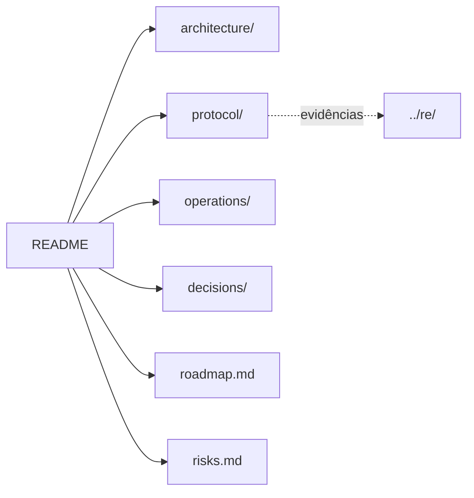

# LandMass Emulator — Documentação técnica

Software Architecture Document dividido por assunto. Comece por **Escopo** e **Contexto**; consulte o resto sob demanda.
Evidências de engenharia reversa (endereços, pseudocódigo, capturas) ficam em [`../re/`](../re/NOTES.md). Estes documentos descrevem o projeto; não registram histórico de desenvolvimento.

## Mapa

## Índice

### Arquitetura — [`architecture/`](architecture/)

| Arquivo | Conteúdo |
|---------|----------|
| [01-scope.md](architecture/01-scope.md) | Objetivos, fora de escopo e restrições obrigatórias (R1–R6). |
| [02-context.md](architecture/02-context.md) | Componentes do sistema, topologia, portas e fluxo ponta a ponta. |
| [03-emulator.md](architecture/03-emulator.md) | Camadas, regras de dependência, estrutura de pacotes, concorrência, codec e handlers. |
| [04-persistence.md](architecture/04-persistence.md) | Banco portável (SQLAlchemy/Alembic), convenção de nomes (Laravel), schema de contas e opções, tabelas do legado não migradas, dados estáticos do cliente. |
| [05-configuration.md](architecture/05-configuration.md) | Variáveis `LANDMASS_*`, valores padrão e regras de segredos. |
| [06-game-server-host.md](architecture/06-game-server-host.md) | Processo que hospeda a partida (componente ausente a reconstruir). |
| [07-progression.md](architecture/07-progression.md) | Progressão e economia: modelo de dados (contas, inventário, morats, opções, social, clãs), regras de compra, uso, presente, patente, recompensa e tutorial, mapeamento opcode → tabela e ordem de implementação. |

### Protocolo — [`protocol/`](protocol/)

| Arquivo | Conteúdo |
|---------|----------|
| [wire-format.md](protocol/wire-format.md) | Framing TCP, cabeçalho `opcode/net_code`, convenções de structs e strings. |
| [authentication.md](protocol/authentication.md) | Login por token (`login_num`), chave de sessão entre Message e Channel, geração de credenciais e sequência de login. |
| [message-server.md](protocol/message-server.md) | Opcodes e mensagens da porta 7313. |
| [channel-server.md](protocol/channel-server.md) | Opcodes e mensagens da porta 7314, incluindo `GS_*`. |

### Operação — [`operations/`](operations/)

| Arquivo | Conteúdo |
|---------|----------|
| [running-client.md](operations/running-client.md) | Como iniciar o cliente contra o emulador, parâmetros obrigatórios, modo janela. |
| [game-server.md](operations/game-server.md) | Cópia do servidor de partida (`servidor-partida`), patches, `servidor.bat`, porta UDP 7777 e sinais no log. |
| [testing.md](operations/testing.md) | Níveis de teste, fixtures de captura e gates de qualidade. |
| [reverse-engineering.md](operations/reverse-engineering.md) | Ferramentas (REA, Ghidra), fontes de verdade e como registrar achados. |

### Decisões e planejamento

| Arquivo | Conteúdo |
|---------|----------|
| [decisions/README.md](decisions/README.md) | Registro de decisões de arquitetura (ADR). |
| [roadmap.md](roadmap.md) | Marcos e critérios de aceite. |
| [risks.md](risks.md) | Riscos, impacto e mitigação. |

## Manutenção

- Altere o arquivo do assunto afetado; mantenha cada arquivo focado em um tema.
- Registre toda decisão nova em [decisions/README.md](decisions/README.md).
- Atualize este índice ao criar, renomear ou remover arquivos.
