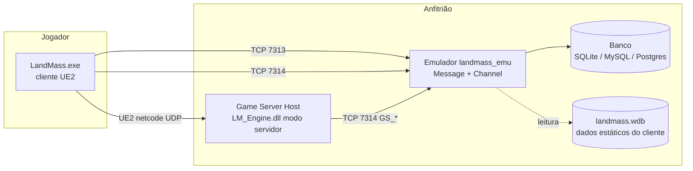
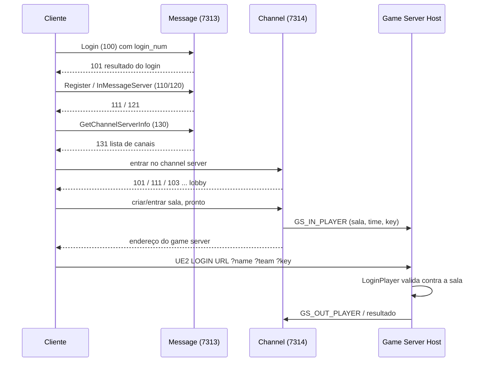

# Contexto e topologia

## Componentes

| Componente | Origem | Papel |
|------------|--------|-------|
| Cliente (`LandMass.exe`, `LM_Engine.dll`, `+server_interface.dll`) | binário original | UI, lobby, partida como cliente UE2 |
| Emulador (`landmass_emu`) | este projeto | Message Server, Channel Server, persistência |
| Game Server Host | **a construir** — ver [06-game-server-host.md](06-game-server-host.md) | Hospeda a partida e valida jogadores contra a sala do Channel |
| Banco de contas | este projeto | Contas e progresso — ver [04-persistence.md](04-persistence.md) |
| `landmass.wdb` | cliente | Itens, mapas, níveis (SQLite somente leitura) |

## Portas

| Porta | Protocolo | Serviço | `net_code` | Implementar |
|-------|-----------|---------|-----------:|:-----------:|
| 7313 | TCP | Message Server: login, canais, amigos, clã, ranking | 13 | sim |
| 7314 | TCP | Channel Server: lobby, salas, loja, hangar, game servers | 14 | sim |
| 7312 | TCP | Update Server | 12 | não — o Launcher de 2009 usa FTP e é ignorado |
| 7310 | TCP | ServerManager (interno entre servidores) | 10 | não |
| configurável | UDP | Partida UE2 (Game Server Host) | — | via host |

Execute Message e Channel no mesmo processo e no mesmo event loop.

## Fluxo ponta a ponta

Opcodes detalhados em [../protocol/](../protocol/wire-format.md).
