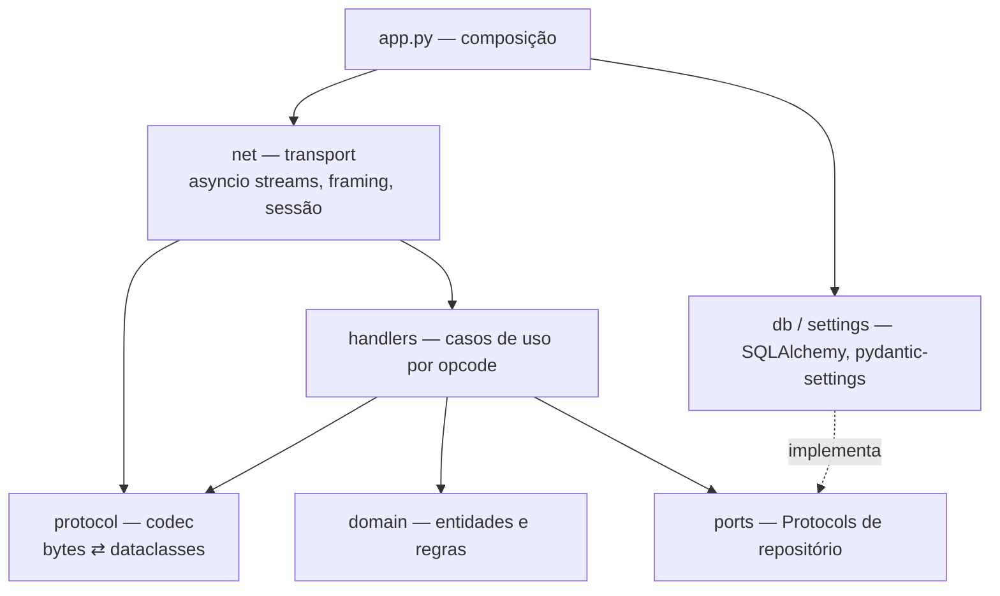
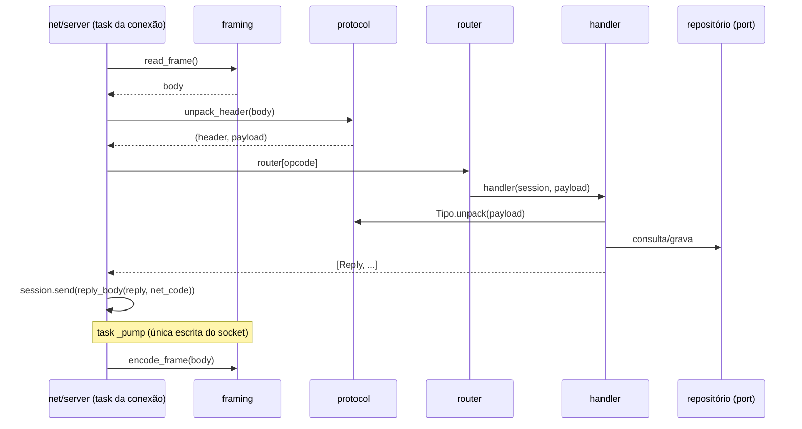

# Arquitetura do emulador

## Camadas

Regras de dependência:

- `protocol` e `domain` não importam `net` nem `db`.
- `handlers` dependem de `ports` (Protocols) e de `protocol`; nunca de SQLAlchemy. Recebem `net.session.Session` (estado da conexão, sem socket).
- `domain` não importa `net`: o lobby guarda destinatários por um Protocol (`send(body: bytes)`), e `net.session.Session` o satisfaz.
- `db` implementa `ports`. Componha tudo em um único ponto: `app.py`.

## Estrutura de pacotes

| Caminho | Responsabilidade |
|---------|------------------|
| `src/landmass_emu/__main__.py` | CLI: `serve`, `sniff`, `account create`, `account token`. |
| `src/landmass_emu/app.py` | Composição: repositório, registro de chaves, roteador, servidores (`game_servers`, `message_server`, `channel_server`, `open_accounts`). |
| `src/landmass_emu/admin.py` | Operações de conta da CLI: criar, regenerar token, gravar `.bat`. |
| `src/landmass_emu/settings.py` | Configuração (`pydantic-settings`), ver [05-configuration.md](05-configuration.md). |
| `src/landmass_emu/net/framing.py` | Leitura/escrita de frames `u16 + body`. |
| `src/landmass_emu/net/session.py` | Estado por conexão: peer, conta autenticada e `outbox` (corpos a enviar). |
| `src/landmass_emu/net/server.py` | `start_service` por serviço: loop de leitura, timeout, roteamento, task de escrita, heartbeat opcional e `on_close`. |
| `src/landmass_emu/protocol/header.py` | Cabeçalho `(opcode << 5) \| net_code`. |
| `src/landmass_emu/protocol/message.py` | Structs `MS_*` e `LM_*` do Message Server (requisições e respostas). |
| `src/landmass_emu/protocol/channel.py` | Structs `CS_*` do Channel Server (marco 2): entrada, lobby, chat, heartbeat. |
| `src/landmass_emu/protocol/game.py` | Structs `GS_*` (marco 4). |
| `src/landmass_emu/handlers/message/` | `__init__.py` (roteador `build_router`), `account.py` (100, 110, 120), `channel_list.py` (130). |
| `src/landmass_emu/handlers/login.py` | Autenticação por token (`login_num`), usada pelo Message (100). O Channel usa a chave de sessão. |
| `src/landmass_emu/handlers/channel/` | `__init__.py` (roteador `build_router`), `entry.py` (100, 120, 122, queda), `chat.py` (240), `options.py` (544). Salas, loja, hangar e partida nos marcos 3 a 5. |
| `src/landmass_emu/domain/lobby.py` | Lobby em memória: membros por `client_guid`, `broadcast` com exclusão opcional. |
| `src/landmass_emu/domain/` | `account.py` (conta, token), `channel.py` (canal), `lobby.py` (presença do lobby), `session_keys.py` (chaves de sessão em memória). Demais entidades nos marcos seguintes. |
| `src/landmass_emu/ports/accounts.py` | Protocol `AccountRepository` e exceção `AccountConflict`. |
| `src/landmass_emu/ports/options.py` | Protocol `OptionsRepository` (`get` e `save` das opções do jogador, `account_options`). |
| `src/landmass_emu/ports/session_keys.py` | Protocol `SessionKeyRegistry` (`issue` e `resolve` de chaves de sessão). |
| `src/landmass_emu/db/` | `models.py` (`accounts`, `account_options`), `accounts.py` (repositório SQLAlchemy), `options.py` (repositório de opções), `engine.py` (migrações no start), `migrations/` (Alembic). |
| `src/landmass_emu/sniffer.py` | Captura de tráfego do cliente (ferramenta de RE). |
| `tests/fixtures/` | Capturas reais usadas como golden files. |

## Concorrência

- Um event loop `asyncio`. Por conexão: uma task de leitura (`_loop`), uma task de escrita (`_pump`) e, no Channel, uma task de heartbeat (`_beat`).
- Só `_pump` grava no socket. Respostas e broadcasts são enfileirados em `Session.outbox` com `Session.send`; quem enfileira em outra conexão nunca escreve no socket dela.
- Nenhum IO bloqueante no loop. Banco via drivers async (`aiosqlite`, `asyncpg`, `asyncmy`).
- Estado em memória (lobby, salas, online) em serviços de domínio de instância única, acessados só pelo loop. Sem persistência de presença (D12).
- Leitura de frame com `asyncio.timeout(LANDMASS_RECV_TIMEOUT)`. Heartbeat do cliente conta como tráfego e não recebe resposta. Heartbeat do servidor no canal: a cada 10 s.

## Codec

- Cada struct: `@dataclass(frozen=True, slots=True)` com `pack()`/`unpack()` sobre `struct.Struct`. Respostas têm `opcode: ClassVar[int]` e só `pack()`.
- Tabela explícita `opcode → tipo` por serviço. Opcode desconhecido: log com hexdump, conexão mantida.
- Struct novo exige teste de ida e volta; com captura disponível, teste contra o `.bin` real. Respostas sem captura são testadas por offsets explícitos sobre os bytes.

## Handlers

- Assinatura: `async def handler(session: Session, payload: bytes) -> Sequence[Reply]`. O handler não escreve no socket: devolve as respostas e `net/server.py` as enfileira, com cabeçalho `(reply.opcode << 5) | net_code` (`reply_body`).
- Difusão para outras conexões (lobby): o handler chama `Lobby.broadcast(body)`, que enfileira na `outbox` de cada destinatário. Os corpos são montados com `reply_body`.
- Dependências (repositórios, lista de canais) entram por `functools.partial` na montagem do roteador (`handlers/message/__init__.py`).
- Lista vazia = sem resposta: opcode sem handler, pedido antes do login, heartbeat. Nada disso derruba a conexão.
- Um módulo por grupo de opcodes; roteador em tabela explícita (`build_router`), sem descoberta automática.

## Ciclo de uma requisição

