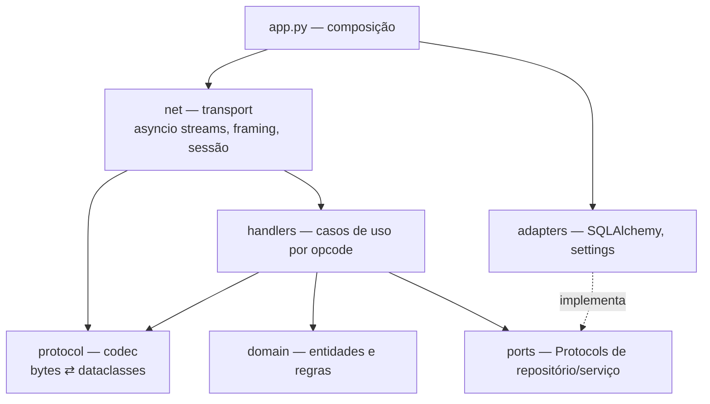
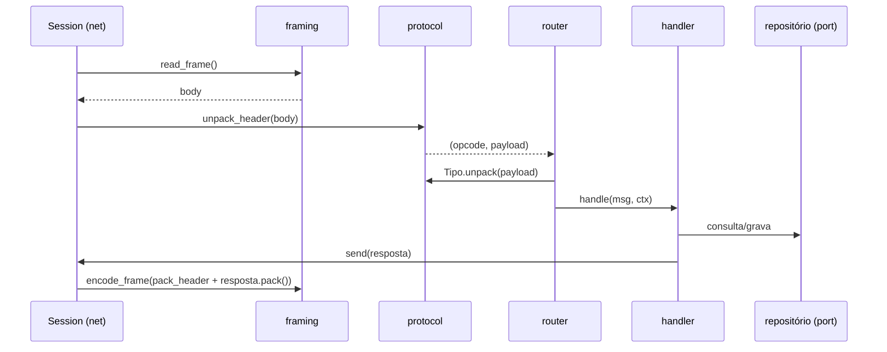

# Arquitetura do emulador

## Camadas

Regras de dependência:

- `protocol` e `domain` não importam `net` nem `adapters`.
- `handlers` dependem de `ports` (Protocols), nunca de SQLAlchemy.
- `adapters` implementam `ports`. Componha tudo em um único ponto: `app.py`.

## Estrutura de pacotes

| Caminho | Responsabilidade |
|---------|------------------|
| `src/landmass_emu/__main__.py` | CLI: `serve`, `sniff`, `account create/token/list`. |
| `src/landmass_emu/app.py` | Composição: settings, engine, repositórios, servidores. |
| `src/landmass_emu/settings.py` | Configuração (`pydantic-settings`). |
| `src/landmass_emu/net/framing.py` | Leitura/escrita de frames `u16 + body`. |
| `src/landmass_emu/net/session.py` | Estado por conexão, envio serializado, heartbeat e timeout. |
| `src/landmass_emu/net/server.py` | `start_server` por serviço; roteamento opcode → handler. |
| `src/landmass_emu/protocol/header.py` | Cabeçalho `(opcode << 5) \| net_code`. |
| `src/landmass_emu/protocol/message.py` | Structs `MS_*`. |
| `src/landmass_emu/protocol/channel.py` | Structs `CS_*`. |
| `src/landmass_emu/protocol/game.py` | Structs `GS_*`. |
| `src/landmass_emu/handlers/message/` | Login, registro, lista de canais, amigos, clã. |
| `src/landmass_emu/handlers/channel/` | Lobby, salas, loja, hangar, game server. |
| `src/landmass_emu/domain/` | Conta, personagem, canal, sala, inventário. |
| `src/landmass_emu/ports/` | Protocols de repositório e serviços (relógio, tokens). |
| `src/landmass_emu/db/` | Modelos, repositórios, migrações Alembic. |
| `src/landmass_emu/sniffer.py` | Captura de tráfego do cliente (ferramenta de RE). |
| `tests/fixtures/` | Capturas reais usadas como golden files. |

## Concorrência

- Um event loop `asyncio`; uma task por conexão.
- Nenhum IO bloqueante no loop. Banco via drivers async (`aiosqlite`, `asyncpg`, `asyncmy`).
- Estado em memória (canais, salas, online) em serviços de domínio de instância única, acessados só pelo loop.
- Escrita por conexão serializada na `Session`.

## Codec

- Cada struct: `@dataclass(frozen=True, slots=True)` com `pack()`/`unpack()` sobre `struct.Struct`.
- Tabela explícita `opcode → tipo` por serviço. Opcode desconhecido: log com hexdump, conexão mantida.
- Struct novo exige teste de ida e volta; com captura disponível, teste contra o `.bin` real.

## Handlers

- Assinatura: `async def handle(msg, ctx: HandlerContext) -> None`; respostas via `ctx.session.send(...)`.
- `HandlerContext`: sessão, repositórios (Protocols), serviços de domínio, relógio.
- Um módulo por grupo de opcodes; registro em tabela explícita, sem descoberta automática.

## Ciclo de uma requisição

