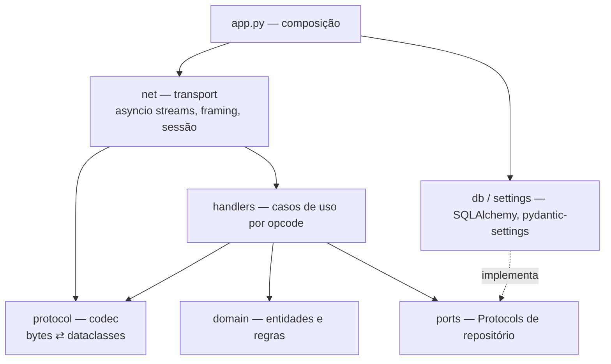
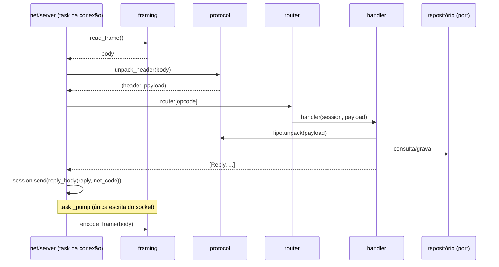

# Arquitetura do emulador

## Camadas

Regras de dependência:

- `protocol` e `domain` não importam `net` nem `db`.
- `handlers` dependem de `ports` (Protocols) e de `protocol`; nunca de SQLAlchemy. Recebem `net.session.Session` (estado da conexão, sem socket).
- `domain` não importa `net`: o lobby guarda destinatários por um Protocol (`send(body: bytes)`), e `net.session.Session` o satisfaz.
- `db` implementa `ports`. Componha tudo em um único ponto: `app.py`.

## Estrutura de pacotes

| Caminho | Responsabilidade |
|---------|------------------|
| `src/landmass_emu/__main__.py` | `Cli` (`serve`, `account`); `main` é o entry point. Comandos: `serve`, `sniff`, `account create`, `account token`, `account grant`, `account ban`, `account unban`, `account access`, `shop sync`, `shop list`, `shop enable`, `shop disable`, `shop price`. |
| `src/landmass_emu/app.py` | Composição: repositório, registro de chaves, roteador, servidores (`game_servers`, `message_server`, `channel_server`, `open_accounts`). |
| `src/landmass_emu/admin.py` | `AccountAdmin`: operações de conta da CLI (criar, regenerar token, gravar `.bat`, bloquear e desbloquear, D106). `ProgressionAdmin`: concessão de exp, LD e Cash (`account grant`). |
| `src/landmass_emu/admin_shop.py` | `ShopAdmin`: loja da CLI (`shop sync` do wdb, listar, habilitar, desativar e mudar preço por nível), D191. |
| `src/landmass_emu/settings.py` | Configuração (`pydantic-settings`), ver [05-configuration.md](05-configuration.md). |
| `src/landmass_emu/net/framing.py` | Leitura/escrita de frames `u16 + body`. |
| `src/landmass_emu/net/session.py` | Estado por conexão: peer, conta autenticada e `outbox` (corpos a enviar). |
| `src/landmass_emu/net/server.py` | `Service` (`start(host, port)`): um serviço TCP com loop de leitura, timeout, roteamento, task de escrita, heartbeat opcional e `on_close`. `reply_body` é o envelope de cabeçalho. |
| `src/landmass_emu/protocol/header.py` | Cabeçalho `(opcode << 5) \| net_code`. |
| `src/landmass_emu/protocol/message.py` | Structs `MS_*` e `LM_*` do Message Server (requisições e respostas). |
| `src/landmass_emu/protocol/channel.py` | Structs `CS_*` do Channel Server (marcos 2 e 3): entrada, lobby, chat, heartbeat, salas e listas. |
| `src/landmass_emu/protocol/progression.py` | Structs de progressão do Channel (F2, F3): tutorial (600/601), saldos (900/902) e `PlayerRecord`, o registro de progressão do 101. |
| `src/landmass_emu/protocol/game.py` | Structs `GS_*` (marco 4). |
| `src/landmass_emu/handlers/message/` | `__init__.py` (`MessageHandlers`: monta o `router`), `account.py` (`AccountHandlers`: 100, 110, 120 e a autenticação por token de 100), `channel_list.py` (`ChannelListHandlers`: 130). |
| `src/landmass_emu/handlers/channel/` | `__init__.py` (`ChannelHandlers`: monta os handlers e a tabela opcode → método), `entry.py` (`EntryHandlers`: 100, 120, 122, queda), `chat.py` (`ChatHandlers`: 240), `gm.py` (`GmHandlers`: 250, 251, 700, 701; D193), `rooms.py` (`RoomHandlers`: 301, 311, 321, 401, 420, 700), `lists.py` (`ListHandlers`: 545, 546), `records.py` (`ChannelRecords`: registros de sala e de jogador), `options.py` (`OptionHandlers`: 544), `progression.py` (`ProgressionHandlers`: 600; registro e saldos do login, exp do 121). Loja, hangar e partida nos marcos 4 e 5. |
| `src/landmass_emu/domain/lobby.py` | Lobby em memória: membros por `client_guid`, `broadcast` com exclusão opcional. |
| `src/landmass_emu/domain/` | `account.py` (conta, token), `access.py` (nível de acesso GM, D193), `channel.py` (canal), `lobby.py` (presença do lobby), `rooms.py` (salas em memória: `Rooms`, `Room`), `session_keys.py` (chaves de sessão em memória), `progression.py` (saldos, tutorial e patente: `RankTable`, `ProgressionService`). Demais entidades nos marcos seguintes. |
| `src/landmass_emu/ports/accounts.py` | Protocol `AccountRepository` e exceção `AccountConflict`. |
| `src/landmass_emu/ports/options.py` | Protocol `OptionsRepository` (`get` e `save` das opções do jogador, `account_options`). |
| `src/landmass_emu/ports/progression.py` | Protocol `ProgressionRepository` (`get`, `mark_tutorial` e `grant` da progressão em `accounts`). |
| `src/landmass_emu/ports/session_keys.py` | Protocol `SessionKeyRegistry` (`issue` e `resolve` de chaves de sessão). |
| `src/landmass_emu/db/` | `models.py` (`accounts`, `account_options`, `account_items`, `account_morats`), `accounts.py` (repositório SQLAlchemy), `inventory.py` (inventário), `item_catalog.py` (`ItemCatalog`: itens e morats do `landmass.wdb`), `options.py` (repositório de opções), `progression.py` (progressão da conta), `catalog.py` (`WdbCatalog`: leitura somente leitura do `landmass.wdb`), `engine.py` (`Migrator`: migrações no start), `migrations/` (Alembic). |
| `src/landmass_emu/sniffer.py` | `Sniffer`: captura de tráfego do cliente (ferramenta de RE). `hexdump` é utilitário sem estado. |
| `tests/fixtures/` | Capturas reais usadas como golden files. |

## Concorrência

- Um event loop `asyncio`. Por conexão: uma task de leitura (`_loop`), uma task de escrita (`_pump`) e, no Channel, uma task de heartbeat (`_beat`).
- Só `_pump` grava no socket. Respostas e broadcasts são enfileirados em `Session.outbox` com `Session.send`; quem enfileira em outra conexão nunca escreve no socket dela.
- Nenhum IO bloqueante no loop. Banco via drivers async (`aiosqlite`, `asyncpg`, `asyncmy`).
- Estado em memória (lobby, salas, online) em serviços de domínio de instância única, acessados só pelo loop. Sem persistência de presença (D12).
- Leitura de frame com `asyncio.timeout(LANDMASS_RECV_TIMEOUT)`. Heartbeat do cliente conta como tráfego e não recebe resposta. Heartbeat do servidor no canal: a cada 10 s.

## Codec

- Cada struct: `@dataclass(frozen=True, slots=True)` com `pack()`/`unpack()` sobre `struct.Struct`. Respostas têm `opcode: ClassVar[int]` e só `pack()`.
- Tabela explícita `opcode → tipo` por serviço. Opcode desconhecido: log com hexdump, conexão mantida.
- Struct novo exige teste de ida e volta; com captura disponível, teste contra o `.bin` real. Respostas sem captura são testadas por offsets explícitos sobre os bytes.

## Handlers

- Assinatura: `async def handler(session: Session, payload: bytes) -> Sequence[Reply]`. O handler não escreve no socket: devolve as respostas e `net/server.py` as enfileira, com cabeçalho `(reply.opcode << 5) | net_code` (`reply_body`).
- Difusão para outras conexões (lobby): o handler chama `Lobby.broadcast(body)`, que enfileira na `outbox` de cada destinatário. Os corpos são montados com `reply_body`.
- Dependências (repositórios, lista de canais) entram no `__init__` das classes de handler. `MessageHandlers` e `ChannelHandlers` montam `router` com métodos ligados (`self.metodo`).
- Lista vazia = sem resposta: opcode sem handler, pedido antes do login, heartbeat. Nada disso derruba a conexão.
- Um módulo por grupo de opcodes, com uma classe por assunto e as dependências injetadas no `__init__`. Handlers e serviços são classes; funções soltas ficam só em constantes, utilitários sem estado, codec e a composição de `app.py` (context managers). Roteador em tabela explícita (`ChannelHandlers.router`, `MessageHandlers.router`), sem descoberta automática.

## Ciclo de uma requisição

