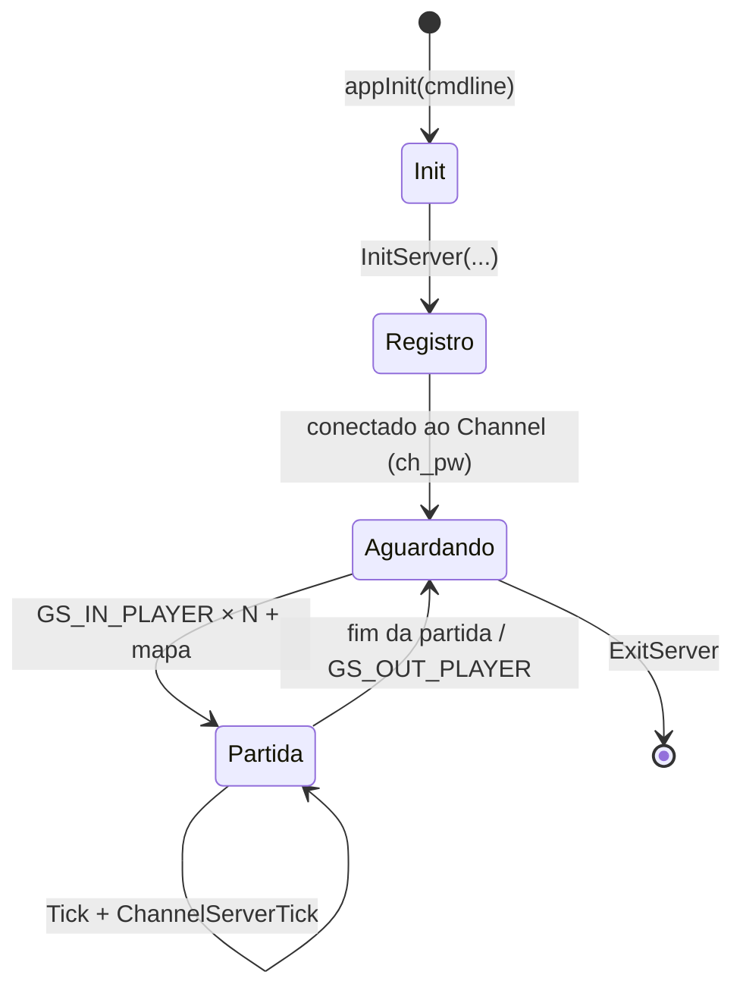

# Game Server Host

## Problema

A partida roda em um processo UE2 em modo servidor. O motor existe em `LM_Engine.dll` (`UServerEngine`,
`UServerLevel`, `CServerRoom`), mas o executável que o inicializava não está nos arquivos disponíveis:
nenhum binário importa `InitServer`. Evidência: [`../../re/NOTES.md`](../../re/NOTES.md), seção "Game server".

## Contrato do motor (exports de `LM_Engine.dll`)

| Export | Função |
|--------|--------|
| `InitServer(wchar* cmdline)` | Lê `ip=`, `port=`, `mode=`, `ch_ip=`, `ch_port=`, `ch_code=`, `ch_pw=`; carrega `ServerMessage.wdb` e `error.wdb`; conecta ao Channel. |
| `ChannelServerTick()` | Processa mensagens `GS_*` do Channel. |
| `LogoutChannelServer()` / `ExitServer()` | Desconexão e encerramento. |
| `ServerRoom()` | Acesso ao `CServerRoom` (jogadores autorizados da sala). |
| `UServerLevel::NotifyReceivedText` | Handshake UE2; no `LOGIN`, chama `LoginPlayer(key, name, team)`. |

## Ciclo de vida exigido

## Abordagens

| Opção | Descrição | Prós | Contras |
|-------|-----------|------|---------|
| A | Host nativo 32-bit mínimo que carrega as DLLs UE2, chama `appInit`, `InitServer` e executa o laço. | Controle total, fiel ao original. | Exige toolchain 32-bit e reproduzir a inicialização UE2. |
| B | `LandMass.exe SERVER` com `INI=` próprio (`GameEngine=LM_Engine.ServerEngine`) + shim que chame `InitServer`. | Reaproveita o launcher do jogo. | `UServerEngine::Init` não chama `InitServer`; requer injeção. |

Escolha a abordagem no marco 3, com base em [../protocol/channel-server.md](../protocol/channel-server.md).

## Requisitos para o emulador

- Implementar o lado servidor das mensagens `GS_*` no Channel: registro do host, `GS_IN_PLAYER`, `GS_OUT_PLAYER`, resultado.
- Validar `ch_pw` contra `LANDMASS_GAME_SERVER_PASSWORD`.
- Anunciar aos clientes o endereço público do host.
