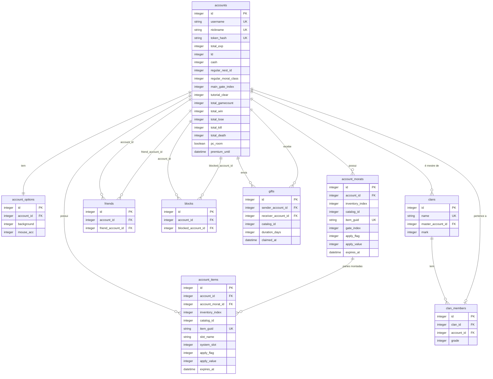

# Progressão e economia

Especificação do servidor para patente, experiência, moedas (LD e Cash), inventário, morats, loja, presente, gacha, tutorial, opções, amigos, bloqueios, clã e ranking.

Fora de escopo: a partida em si ([06-game-server-host.md](06-game-server-host.md)), salas, chat e penalidades (ver §8).

## 1. Convenções e fontes

- **Contrato com o cliente**: opcodes, layouts, ordem de bytes e comportamento observável. É o único ponto em que o servidor segue o legado ([D17](../decisions/README.md)).
- **(inferido)**: dedução sem evidência direta no cliente. Sem marca: visto no código do cliente, no `landmass.wdb` ou no legado.
- Evidências: [`re/features.md`](../../re/features.md) (citado por seção), [`re/channel_server.md`](../../re/channel_server.md) e [`re/message_server.md`](../../re/message_server.md) (opcodes e layouts), `landmass.wdb` (somente leitura, D7), dump UnrealScript de `LM_Engine.u`, `XInterface.u` e `XGame.u` (citado por função).
- Legado `LM_account.sql`: usado só como pista de regra de negócio. Nenhuma coluna ou procedure é copiada por ser legada.

## 2. Princípios do servidor

1. **Um processo `asyncio`** ([D1](../decisions/README.md)). Sem serviço auxiliar, sem link entre servidores, sem job de cópia.
2. **Serviços de domínio em memória** de instância única para o efêmero (presença, lobby, sala). **Persistência** por repositório SQLAlchemy atrás de `ports/`.
3. **Transação curta**: uma unidade de trabalho por pedido, aberta no handler e confirmada antes de enfileirar a resposta. Nenhum IO de rede dentro da transação.
4. **Regras no domínio**: funções Python puras, testáveis sem banco. O repositório só lê e grava. Nenhuma procedure, trigger ou função de banco.
5. **Estado de jogador é lido do banco a cada pedido**. Não há cache de inventário, saldo ou opções. O único cache é o catálogo estático ([D19](../decisions/README.md)).
6. **Economia serializada por conta**: `asyncio.Lock` por `account_id` em torno de compra, uso, destruição, extensão e presente. Débito por `UPDATE` condicional ([D20](../decisions/README.md)).
7. **Sem histórico**: nenhuma tabela de log, auditoria ou contador ([D12](../decisions/README.md)).

## 3. Legado: o que não é copiado

Cada linha registra a regra que sobrevive. O mecanismo do legado não é reproduzido.

| Legado | Tratamento no servidor | Regra resultante |
|--------|------------------------|------------------|
| `tbl_item_del`, `tbl_morats_del`, `tbl_friends_del`, `tbl_account_del`, `tbl_nickname_del` | `DELETE` na linha | Item destruído some. Sem histórico. |
| `tbl_loginlog`, `tbl_clanlog`, `tbl_logincount`, `tbl_usercount`, `tbl_concurrent`, `tbl_date_member`, `tbl_group_usercount` | Não migrar | Métricas sob demanda (D12). |
| `tbl_login`, `GameLogin`, `GameLogout`, `InsertLogIn` | Presença em memória da sessão | Online = conexão autenticada ativa. |
| `tbl_index` | `id` autoincremento | Sem gerador de IDs. |
| `tbl_account.item_number` com `InsertItem`/`DeleteItem`/`SaveItem` ajustando o contador | Contagem por consulta | Nenhum contador denormalizado. |
| `tbl_ranking` e `usp_renew_ranking` (job que recalcula cópia) | Consulta sobre `accounts` | Ranking em tempo real ([D18](../decisions/README.md)). |
| `SaveAccountInfo`, `SaveAccountInfoItem`, `SaveAccountNestRecord`, `SaveAccountRecord` (regravam o estado inteiro) | Atualização por campo, no repositório da conta | Grava só o que mudou. |
| `SavePointCash`, `SavePromotion`, `SavePromotionNest`, `SaveOperator`, `SaveEngineer`, `SaveCostume`, `SaveClanMasterLevel` | Operações de domínio | Saldo via serviço econômico (§5.1). Patente derivada, não gravada (§5.8). |
| `tbl_quickslot` | Não migrar | Quickslot removido do cliente (features §4). |
| `tbl_temp_user`, `usp_insert_morats_temp`, `tbl_tool_patch` | Não migrar | Sem uso no cliente. |
| `tbl_option_list` | Não migrar | Descrições de opções não são lidas pelo servidor. |
| `ssn_first`, `ssn_second`, `userpw`, `userid` (cópia de login) | Não gravar CPF/SSN; login é `username`, senha é token | Privacidade e [authentication.md](../protocol/authentication.md). |
| `week_exp`, `month_exp`, `operator`, `engineer`, `promotion`, `oddeye_*`, `shadow_*`, `leon_*` | Não migrar no primeiro corte | Nenhum leitor no cliente. Por nest, ver dúvida 22. |
| `total_secedecount` | Não armazenar | Abandono é calculado pelo cliente (R-ABN, §5.13). |
| `tbl_penalty_list` | Fora deste documento | Ver dúvida 21. |

## 4. Modelo de dados

### 4.1 Convenções

- Tipos portáveis ([04-persistence.md](04-persistence.md)): `Integer`, `String(n)`, `Boolean`, `DateTime(timezone=True)`.
- Toda tabela tem `id` (`Integer`, PK, autoincremento), `created_at` e `updated_at`.
- `catalog_id` (`Integer`, sem FK): id do cliente. Identidade no catálogo: `item.type` (consumíveis e skins), `Item_Equip.item_id` (equipamentos) e `Morats.id` (espécies). Ver [D19](../decisions/README.md).
- `item_guid` (`String(36)`): UUID v4 gerado pelo servidor. O cliente identifica a unidade por ele (`LM_ITEM_INFO.strItemGuid`).
- `inventory_index` (`Integer`): índice por conta, o `siIdx` do cliente. É o menor índice livre na criação e só é reaproveitado após `DELETE` ([D22](../decisions/README.md)).
- Constraints e índices seguem `<tabela>_<coluna>_unique|index|foreign`; constraints compostas unem as colunas com `_`.

### 4.2 Diagrama

`account_options` tem 37 colunas `Integer` (§4.6); o diagrama mostra só duas. `catalog_id` referencia o catálogo estático e não aparece como entidade.

### 4.3 `accounts`: colunas novas

A tabela `accounts` existente ([04-persistence.md](04-persistence.md)) recebe as colunas abaixo. Padrão de todas: `0`, salvo indicação.

| Coluna | Tipo | Nulo | Origem | Uso |
|--------|------|------|--------|-----|
| `total_exp` | `Integer` | não | `tbl_account.total_exp`; `iTotalExp` | Experiência total. Fonte da patente (R-LVL). |
| `ld` | `Integer` | não | `tbl_account.point`; `iPoint` | Saldo de LD (`PointUnit`). ≥ 0 pelo `UPDATE` condicional (R-DEB). |
| `cash` | `Integer` | não | `tbl_account.cash`; `iCash` | Saldo de Cash (`CashUnit`). ≥ 0 pelo mesmo critério. |
| `regular_nest_id` | `Integer` | sim | `tbl_account.nest`; `ucNest` | Nest regular: 1 Oddeye, 2 Shadow, 3 Leon. |
| `regular_morat_class` | `Integer` | sim | (novo) | Classe regular: 1 a 4 (R-REG). |
| `main_gate_index` | `Integer` | sim | (novo) | Gate da morat principal, 0 a 7 (R-MAIN). |
| `tutorial_clear` | `Integer` | não | `tbl_account.tutorial_clear`; `iTutorialClear` | Máscara de bits do tutorial (R-TUT). |
| `total_gamecount` | `Integer` | não | `total_gamecount` | Partidas jogadas. |
| `total_win` | `Integer` | não | `total_win` | Vitórias. |
| `total_lose` | `Integer` | não | `total_lose` | Derrotas. |
| `total_kill` | `Integer` | não | `total_kill` | Abates. |
| `total_death` | `Integer` | não | `total_death` | Mortes. |
| `pc_room` | `Boolean` | não | `pc_room` | Jogador em sala de PC (bônus, R-REW-08). |
| `premium_until` | `DateTime(tz)` | sim | `premium_end` | Fim do premium (R-MON-05). |

`total_secedecount` não entra: o cliente calcula o abandono (R-ABN).

### 4.4 `account_items`

Inventário. Uma linha por unidade ([D22](../decisions/README.md)). "Equipado" é derivado: `account_morat_id IS NOT NULL OR system_slot IS NOT NULL`. O gate de um item montado é o `gate_index` da morat dona.

| Coluna | Tipo | Nulo | Regra |
|--------|------|------|-------|
| `account_id` | `Integer` | não | FK `accounts.id`: `account_items_account_id_foreign`. |
| `inventory_index` | `Integer` | não | `siIdx`. Único por conta: `account_items_account_id_inventory_index_unique`. |
| `catalog_id` | `Integer` | não | Id do cliente (ex.: `201010001`). Sem FK (D19). |
| `item_guid` | `String(36)` | não | Único: `account_items_item_guid_unique`. |
| `account_morat_id` | `Integer` | sim | FK `account_morats.id`: `account_items_account_morat_id_foreign`. Preenchido quando é parte de uma morat. |
| `slot_name` | `String(20)` | sim | Slot dentro da morat (§5.4). Único por morat: `account_items_account_morat_id_slot_name_unique`. |
| `system_slot` | `Integer` | sim | 0 a 9 (`sEventSlot[10]`). Único por conta: `account_items_account_id_system_slot_unique`. |
| `apply_flag` | `Integer` | não | Enum `ITEM_APPLY` do cliente: 0 UNLIMIT, 1 SIZE, 2 REALTIME, 3 PLAYTIME, 4 ENABLE (inferido: pela ordem do enum). Padrão 0. |
| `apply_value` | `Integer` | sim | Usado por SIZE, PLAYTIME e ENABLE. Nulo em REALTIME. |
| `expires_at` | `DateTime(tz)` | sim | Usado por REALTIME. Nulo = não iniciado (contrato: `iApplyValue = 0`) ou sem prazo. |

Índice: `account_items_account_morat_id_index`. Na montagem de item em morat, `ON DELETE SET NULL` (inferido): destruir a morat desmonta as partes.

### 4.5 `account_morats`

Unidade de combate (espécie `SPECIES_*`), não moeda ([features §10](../../re/features.md)).

| Coluna | Tipo | Nulo | Regra |
|--------|------|------|-------|
| `account_id` | `Integer` | não | FK `accounts.id`: `account_morats_account_id_foreign`. |
| `inventory_index` | `Integer` | não | Único por conta: `account_morats_account_id_inventory_index_unique`. Dúvida 19. |
| `catalog_id` | `Integer` | não | `Morats.id` (ex.: `101000001`). Sem FK. |
| `item_guid` | `String(36)` | não | Único: `account_morats_item_guid_unique`. |
| `gate_index` | `Integer` | sim | 0 a 7 (`sGate[8]`). Nulo = fora do gate. Único por conta: `account_morats_account_id_gate_index_unique`. |
| `apply_flag`, `apply_value`, `expires_at` | — | — | Iguais a `account_items`. |

### 4.6 `account_options`

Uma linha por conta (1:1). Guarda as 37 opções de `LM_REGISTER_INFO`, que o cliente envia em 544 (`SaveOption`) e recebe em 111 (`MS_REGISTER_OUT`, `@0x00..0x24`).

- Constraints: `account_options_account_id_unique` e `account_options_account_id_foreign`.
- Todas as colunas são `Integer`, `NOT NULL`, padrão `0`, faixa 0 a 255.
- O codec mapeia por índice `@i` (ordem fixa de [message_server.md §4.1](../../re/message_server.md)). A ordem é o contrato; os nomes são só do banco.

| `@i` | Coluna | `@i` | Coluna |
|-----:|--------|-----:|--------|
| 0 | `background` | 19 | `move_left` |
| 1 | `effect` | 20 | `move_right` |
| 2 | `voice_info` | 21 | `fire` |
| 3 | `voice_character` | 22 | `alt_fire` |
| 4 | `mouse_acc` | 23 | `walk` |
| 5 | `mouse_sensitivity` | 24 | `down` |
| 6 | `mouse_invert` | 25 | `jump` |
| 7 | `weapon_1` | 26 | `change_mag` |
| 8 | `weapon_2` | 27 | `chaff` |
| 9 | `weapon_3` | 28 | `booster` |
| 10 | `weapon_4` | 29 | `action` |
| 11 | `weapon_5` | 30 | `speech_menu_1` |
| 12 | `weapon_6` | 31 | `speech_menu_2` |
| 13 | `weapon_7` | 32 | `speech_menu_3` |
| 14 | `weapon_8` | 33 | `object` |
| 15 | `weapon_9` | 34 | `mirror` |
| 16 | `weapon_0` | 35 | `minimap` |
| 17 | `move_forward` | 36 | `screenshot` |
| 18 | `move_backward` | — | — |

Ao implementar, a tabela de índices do codec é a fonte de verdade. A conferência é feita por teste contra a captura.

### 4.7 `friends` e `blocks`

- `friends`: `account_id` e `friend_account_id` (FKs `friends_account_id_foreign` e `friends_friend_account_id_foreign`). Único: `friends_account_id_friend_account_id_unique`. Índice: `friends_friend_account_id_index`.
- `blocks`: mesma estrutura, com `blocked_account_id`. Único: `blocks_account_id_blocked_account_id_unique`. Índice: `blocks_blocked_account_id_index`.
- Relação direcional: adicionar B em A cria uma linha. (inferido: o cliente não tem pedido de confirmação.)
- Sem `last_seen_at`: o log de amigo (`NotifyFriendLog`) não tem opcode (dúvida 16).

### 4.8 `clans` e `clan_members`

- `clans`: `name` (`String(16)`, único: `clans_name_unique`), `master_account_id` (FK `clans_master_account_id_foreign`) e `mark` (`Integer`, id do ícone; `clan_mark`).
- `clan_members`: `clan_id` (FK `clan_members_clan_id_foreign`, índice `clan_members_clan_id_index`), `account_id` (FK `clan_members_account_id_foreign`, único `clan_members_account_id_unique`: uma conta, um clã) e `grade` (`Integer`, `member_grade`).
- Não há `clan_logs`. O legado `tbl_clanlog` é log (D12).

### 4.9 `gifts`

Presente pendente. Linha criada na compra do presente; `claimed_at` nulo = pendente.

| Coluna | Tipo | Nulo | Regra |
|--------|------|------|-------|
| `sender_account_id` | `Integer` | não | FK `gifts_sender_account_id_foreign`. |
| `receiver_account_id` | `Integer` | não | FK `gifts_receiver_account_id_foreign`. Índice `gifts_receiver_account_id_index`. |
| `catalog_id` | `Integer` | não | Id do cliente. Sem FK. |
| `duration_days` | `Integer` | sim | 1, 7, 14 ou 30. Nulo = sem prazo. |
| `claimed_at` | `DateTime(tz)` | sim | Nulo = pendente. |

### 4.10 Ranking: sem tabela

Decisão em [D18](../decisions/README.md). A lista é consulta sobre `accounts`:

- Ordem: `total_exp` decrescente.
- Empate: todos recebem a menor posição do grupo (1, 1, 3, ...).
- Limite: 100 linhas (o laço do cliente para em 100; `MAX_LANK_LIST` não localizado).
- Sem cache. O volume é de dezenas de contas por canal; se a consulta pesar, o índice `accounts_total_exp_index` resolve antes de qualquer cache.

Justificativa: o legado mantinha `tbl_ranking` por job (`usp_renew_ranking`), uma cópia derivada que D12 não admite. O cliente só lê a lista; não há escrita a sincronizar.

## 5. Regras de negócio

Ids `R-*` para referência em testes e na ordem de implementação (§7). Fonte: seção de [features.md](../../re/features.md) ou função/linha do dump.

### 5.1 Moedas e saldo

| Id | Regra | Fonte |
|----|-------|-------|
| R-MON-01 | LD (`PointUnit`) é `accounts.ld`. Cash (`CashUnit`) é `accounts.cash`. Ambos são inteiros ≥ 0. | features §11; `localize` |
| R-DEB-01 | Compra, extensão e presente debitam por `UPDATE accounts SET ld = ld - :p WHERE id = :id AND ld >= :p` (ou `cash`), na mesma transação que cria a linha de item. `rowcount = 0` é saldo insuficiente, e nada é gravado. | (inferido; D20) |
| R-MON-02 | Não há pedido de carga no cliente. LD e Cash entram por recompensa de partida (LD) e por comando de administração (CLI nova `account grant`). | features §11 (inferido) |
| R-MON-03 | Após qualquer mudança de saldo, o canal envia `902` (LD) e/ou `900` (Cash) à conta conectada. Os pushes são a única forma de o cliente atualizar `iPoint` e `iCash`. | features §11 (`OnChargePoint`, `OnChargeCash`) |
| R-MON-04 | Premium: `premium_until` é a data de fim. Enquanto válido, o cliente mostra o estado premium. O push `901` atualiza o cliente. | features §11 (`NotifyChargePremium`) |
| R-MON-05 | Bônus de PC-room é aplicado só a jogadores com `pc_room`. | features §11; `XGame` |

### 5.2 Catálogo e preço

| Id | Regra | Fonte |
|----|-------|-------|
| R-CAT-01 | Grupo = `id / 1e8` (0 nenhum, 1 morat, 2 equipamento, 3 item, 4 efeito). Classe = `(id / 1e6) % 100`. Tipo = `(id / 1e4) % 100`. Índice = `id % 1e4`. | features §0.3 (`GetItemClassify`) |
| R-CAT-02 | Catálogo em memória: `item` (14 ids: consumíveis e skins), `Item_Equip` (61 ids), `Morats` (9 espécies), `GameRewardConstant` (47 chaves), `LevelList` (101 níveis), `gift` (3 pacotes de sistema). | `landmass.wdb` |
| R-PRC-01 | Preço por opção `i` de 0 a 3: duração 1, 7, 14 e 30 dias (`BUY_OPTION1/7/14/30`). Preço em LD é `item_buy_point[i]`; em Cash, `item_buy_cash[i]`. Preço zero na moeda escolhida = não vendido nela. | features §2.2; `XInterface` `InternalOnClose` 12160–12232 |
| R-PRC-02 | Opções 8 e 9 chegam como `nBuyOption = 0`, com `bPoint` igual a true (8, LD) ou false (9, Cash). O pacote não distingue. Tratar como opção 0 (1 dia). | features §2.2 (inferido; dúvida 4) |
| R-PRC-03 | Morat: a UI envia `ItemBuy(id_especie, true, 1)` fixo, com `FIXME` que mapeia 1→0. A UI exibe e valida `nPoint[0] × 5` (inferido: índice 0). | `XInterface` `LM_SupplyMoratsBuyPopPage` 9188–9258; dúvida 1 |

### 5.3 Compra (550 e 551)

| Id | Regra | Fonte |
|----|-------|-------|
| R-BUY-01 | Ordem de validação: conta autenticada; `catalog_id` existe no catálogo; preço > 0 na moeda e opção; saldo suficiente; requisitos atendidos (R-REQ). Qualquer falha responde com código de erro e não grava. | (inferido) |
| R-REQ-01 | Requisitos: `item_required_level`, `item_required_nest`, `item_required_nest_point`, `item_required_clan`, `item_required_clan_rank`, `item_required_rank`, `item_required_class`, `item_required_strength`, `item_required_agility`, `item_required_precision` e `item_required_power`; para morat, `required_*`. O cliente mostra, mas não bloqueia. O servidor valida. | features §2.2 (lacuna; dúvida 10) |
| R-BUY-02 | Efeito de item com duração: cria `account_items` com `apply_flag = 2` (REALTIME) e `expires_at = agora + dias`. Grupo 1 cria `account_morats` com `gate_index` nulo. | (inferido; dúvida 5) |
| R-BUY-03 | Resposta `551` com `result`: 0 ou código de `msg_error`. O cliente chama `RefreshLD` ao receber. | features §2.2 (`NotifyItemBuy(int result)`) |
| R-BUY-04 | Cada compra gera `item_guid` novo e `inventory_index` livre da conta. Nenhuma linha parcial sobrevive a falha (transação). | (inferido; D22) |

### 5.4 Uso, gate e slots de sistema (560, 570, 573)

| Id | Regra | Fonte |
|----|-------|-------|
| R-USE-01 | `ItemUsed(index, gate)` (560, corpo de 8 bytes, dois `u32`): item com `inventory_index = index` é montado no gate `gate` (0 a 7). Se o item é morat (grupo 1), ocupa o gate. Se é parte (grupo 2), vira `account_items.account_morat_id` da morat do gate, com `slot_name` derivado (dúvida 9). Gate sem morat recusa a montagem. | features §3.2 (inferido nos detalhes) |
| R-USE-02 | Gates: 8 por jogador (`sGate[8]`, `LM_GATE_SLOT`: `siIdx`, `bEnable`). Slots de sistema: 10 (`sEventSlot[10]`). | `LM_Engine.u` `LM_PLAYER_INFO` |
| R-USE-03 | Slots de `slot_name` (de `LM_MORATS_INFO`): `main_weapon`, `sub_weapon`, `melee_weapon`, `etc_weapon_00..02`, `booster`, `generator`, `head`, `body`, `arm`, `leg`, `etc_item_00..03`, `skin_00..02`. | `LM_Engine.u` `LM_MORATS_INFO` |
| R-USE-04 | Item de sistema (grupo 3, classe 8) vai para `system_slot` livre, de 0 a 9. Tipo ONCE (1) é consumido no uso. Tipo BUFF (2) permanece até expirar. | features §0.3, §3.2 (inferido nos detalhes) |
| R-USE-05 | `ItemUnused(index, gate)` (570) remove a montagem: zera `account_morat_id`, `slot_name` e `system_slot`. O corpo medido tem 4 bytes (um `u32`), mas a UI passa dois valores. | `channel_server.md` §2; dúvida 8 |
| R-USE-06 | Morat principal: `ItemUsedByValue` não tem método na DLL. O cliente não consegue enviar a troca. `main_gate_index` fica sem escrita até decisão. | features §3.2 (dúvida 7) |
| R-USE-07 | Usar item que não pertence à conta, ou item já montado no mesmo slot, responde erro sem alterar nada. | (inferido) |

### 5.5 Destruição e extensão (555, 556, 580, 582, 585)

| Id | Regra | Fonte |
|----|-------|-------|
| R-DEST-01 | `ItemDestroy(id, index)` (555) remove a linha por `DELETE`, sem histórico (D12). Se o item estava montado, a resposta informa o gate usado (`nUsedGate`) para o cliente atualizar. | features §3.3; `channel_server.md` §3.2 |
| R-DEST-02 | Destruir morat desmonta as partes (R-USE-01 e `ON DELETE SET NULL`). | (inferido) |
| R-EXT-01 | `ItemExtend` (580) tem o mesmo preço de R-PRC-01. Se `expires_at` está no futuro, soma os dias a partir dele. Se é nulo ou vencido, parte de agora. | features §3.3; (inferido) |
| R-EXT-02 | Resposta `582` (`NotifyItemExtend(result, nIndex, bItem)`). | features §3.3 |
| R-EXP-01 | Item REALTIME com `expires_at <= agora` gera o push `585` (`NotifyItemEndtime(nIndex, bItem, premium)`), que abre a tela de renovação. O item fica até renovação ou destruição. Remoção automática não definida (dúvida 5). | features §3.3 (inferido nos detalhes) |
| R-VAL-01 | `apply_value` por flag: REALTIME usa `expires_at` (inferido: `apply_value` com segundos absolutos, `0` quando `expires_at` é nulo); SIZE, PLAYTIME e ENABLE usam `apply_value` direto. | `LM_Engine.u` `ITEM_APPLY`; `XInterface` 36788–36798 (inferido nos valores) |

### 5.6 Presente (615, 616, 610, 611, 612, 613)

| Id | Regra | Fonte |
|----|-------|-------|
| R-GIFT-01 | Envio (615): o remetente paga pela mesma tabela de R-PRC-01 e escolha de opção. Cria `gifts` com `claimed_at` nulo. Destinatário resolvido por `strNick`. Nick inexistente responde erro. Envio a si mesmo responde erro (inferido). | features §2.3; `XInterface` 12203–12219 |
| R-GIFT-02 | Patente mínima: o cliente bloqueia se `iTotalExp < EnableGiftExp`. Com o `landmass.wdb`, `EnableGiftExp = -1` (nível 0, "Sem Patente", `event = enable_gift`). A condição nunca é verdadeira. O servidor aplica a mesma checagem com o valor do wdb, sem regra nova. | `XInterface` 12022, 22970; `PrecessLevelList` (`LM_Engine.u`); dúvida 2 |
| R-GIFT-03 | Lista (610): paginada, 12 itens por página (`LM_HangerPage`). Retorna presentes pendentes do destinatário. Resposta `611` (`NotifyGetGiftItem(result, page)`). | features §2.3 |
| R-GIFT-04 | Resgate: `GiftItemUsed` (612) tem wrapper e nenhum chamador na UI. Não há caminho de resgate no cliente. Até decisão (dúvida 3), o resgate ocorre na listagem (inferido) e marca `claimed_at`. | features §2.3; dúvida 3 |
| R-GIFT-05 | Pacotes `gift` do wdb (`gift_okcashback1..3`) são itens de sistema com `item_id`, `apply_flag` e `apply_value`. Quem os concede não aparece no cliente. | `landmass.wdb` `gift` (inferido: concessão pelo servidor) |

### 5.7 Gacha (591)

| Id | Regra | Fonte |
|----|-------|-------|
| R-GACHA-01 | Item `308010006` ("Item Surpresa", ONCE) gera sorteio no servidor. O resultado sai em 591 (push) como lista `LM_GATCHA_PRIZE` (`item_id`, `size`, `buy_option`, `description`). | features §2.4 |
| R-GACHA-02 | Prêmio LD vai para `accounts.ld`. Prêmio de item vai para `account_items` com as regras de R-BUY-02. | features §2.4 (inferido) |
| R-GACHA-03 | Tabela de sorteio, pesos e pool: não existem no cliente nem no wdb. Definição pendente (dúvida 6). | features §2.4 (lacuna) |

### 5.8 Experiência e patente

| Id | Regra | Fonte |
|----|-------|-------|
| R-LVL-01 | Patente (nível) = maior `n` tal que `total_exp >= LevelList.exp[n]`. Nível 0 tem `exp = -1`, e nível 1 ("Novato") começa em 0. Máximo: nível 100. | `LM_Engine.u` `GetLevelInfo` (dump, função estática) e `PrecessLevelList` |
| R-LVL-02 | A patente não é coluna (D21). Nome do nível: `LevelList.levelname`. | D21 |
| R-LVL-03 | Progresso exibido pelo cliente: `(exp − exp[n]) / (exp[n+1] − exp[n])`. O servidor envia só `total_exp`. | `GetLevelInfo` (`ExpPer`) |
| R-LVL-04 | Níveis 95 a 100 têm `exp = 2147483647`: inalcançáveis na prática. | `landmass.wdb` `LevelList` |
| R-LVL-05 | Nível "Praça" (nível 2, `exp = 2800`) é marcado `select_nest`. O cliente não lê `SelectNestExp` em nenhuma tela (só é declarado). Exigir esse nível para `SetRegular` é proposta, não regra do cliente (dúvida 11). | `PrecessLevelList`; grep em `XInterface` e `XGame` |
| R-LVL-06 | Não há mensagem de "subiu de patente". O cliente recalcula pelo `total_exp` recebido. | (inferido) |

### 5.9 Recompensa de partida

Cálculo por jogador, no fim da partida. Constantes de `GameRewardConstant` (valores no wdb, não copiados no banco). Entradas de cada modo: kills, takes, rodadas, pontuação de meta, ranking e NumPlayers, todos vindos da partida (marco 4).

| Id | Regra | Fonte |
|----|-------|-------|
| R-REW-01 | **DM**: `matchExp = GoalScore / DM_MatchExp` se `NumPlayers >= 6`; senão `GoalScore / (DM_MatchExp / (NumPlayers / MaxPlayers))`. | `XGame` cálculo DM (~16205–16216) |
| R-REW-02 | **DM exp**: `killExp = kills × DM_KillExp`; `takeExp = matchExp × DM_TakeExp × (maxKills / GoalScore) × playRate`; `winExp = matchExp × DM_WinExp × (maxKills / GoalScore)`, multiplicado por `DM_RankBonusExp_1` (1º), `_2` (até 5%), `_3` (10%), `_4` (15%), `_5` (20%), `_6` (30%); zero acima de 30%. `exp = killExp + takeExp + winExp`. | `XGame` ~16231–16260 |
| R-REW-03 | **DM LD**: `killMoney = killExp × DM_KillPoint`; `takeMoney = takeExp × DM_TakePoint`; `winMoney = winExp × DM_WinPoint`. `money = soma`. | `XGame` ~16262–16275 |
| R-REW-04 | **OP exp**: `matchExp = (rodadasVencedor × OP_MatchExp_1) / OP_MatchExp_2` (com ajuste igual ao de DM para `NumPlayers < 6`). `killExp = kills × OP_KillExp`; `takeExp = matchExp × OP_TakeExp × playRate`; `winExp = matchExp × OP_WinExp × playRate` só para o time vencedor; `missionBonusExp = serviceScore × OP_MissionBonusExp`. `exp = soma`. | `XGame` `LM_TeamOperation` ~6520–6584 |
| R-REW-05 | **OP LD**: `killMoney = killExp × OP_KillPoint`; `takeMoney = takeExp × OP_TakePoint`; `winMoney = winExp × OP_WinPoint`; `missionBonusMoney = missionBonusExp × OP_MissionBonusPoint`. `money = soma`. | `XGame` ~6586–6604 |
| R-REW-06 | **TDM e BR**: constantes existem (`TDM_*`, `BR_*`); as fórmulas não foram lidas nesta revisão. Lacuna (dúvida 14). | features §1.2 |
| R-REW-07 | `playRate` tem duas definições: DM usa tempo (`(ElapsedTime − StartTime) / ElapsedTime`, ~16349); OP usa rodadas (`JoinRound`, ~6698). Cada modo usa a sua. | `XGame` (dúvida 14) |
| R-REW-08 | Ordem após o cálculo base: (1) `× ExpMult` e `× MoneyMult` se > 0 (ambos 1); (2) bônus PC-room com `pc_room`: `exp += exp × PCRoomBonusExp` e `money += money × PCRoomBonusPoint` (valor 1 = +100%, inferido); (3) bônus de evento: `exp += exp × BonusExpMult` e `money += money × BonusMoneyMult` (origem não localizada); (4) buffs: `exp × 1.5` se `bExpIncrement` (item `308020001`) e `money × 1.5` se `bLDIncrement` (item `308020002`). | `XGame` 6625–6640, 16296–16311; `ApplySysItmValue` 16852 |
| R-REW-09 | Tipo de vitória: time vencedor (OP e TDM) ou ranking 1 (DM). Não há campo de vitória no cliente; a regra é (inferido). | (inferido) |
| R-REW-10 | Gravação: uma transação por partida que soma `total_exp`, `ld`, `total_gamecount` e `total_win`/`total_lose`/`total_kill`/`total_death` de cada jogador. Os valores float são convertidos para inteiro (regra de arredondamento: dúvida 13). | (inferido; D20) |
| R-REW-11 | Resultado entra no canal pelo caminho GS_* (opcode de resultado não documentado; dúvida 17). | `channel_server.md` §4 |

### 5.10 Tutorial (600, 601)

| Id | Regra | Fonte |
|----|-------|-------|
| R-TUT-01 | Três passos (movimento, tiro e engenheiro). Pedido `ClearTutorial(u8 índice)`, com índice 0 a 2. Bit = `1 << índice` (`0x1`, `0x2`, `0x4`) (inferido pela máscara do cliente). Operação é OR no campo, idempotente. | features §1.1 (`iTutorialClear & 0x0001/0x0002/0x0004`) |
| R-TUT-02 | O cliente só envia o passo quando o bit não está marcado (`LM_TutorialCompletePage`, 6080–6125). | features §1.1 |
| R-TUT-03 | Resposta com `Tutorial`, `Point` e `Result` (`NotifyTutorialClear`). Código de resposta não atribuído: o bloco 902 é misto (dúvida 15). | features §1.1; `channel_server.md` §3.2 |
| R-TUT-04 | Não há recompensa de tutorial no cliente (features §1.1). Nenhuma recompensa é concedida (inferido). | features §1.1 |

### 5.11 Morats regulares (105, 104)

| Id | Regra | Fonte |
|----|-------|-------|
| R-REG-01 | `SetRegular(nest, classe)`: `nest` ∈ {1, 2, 3} (Oddeye, Shadow, Leon); `classe` ∈ {1 ASSAULT, 2 SNIPER, 3 DEFENDER, 4 ENGINEER}. A classe 5 (SPECIAL) não é selecionável. | `LM_Engine.u` `SetRegular` 1843–1851; features §10 |
| R-REG-02 | Grava `regular_nest_id` e `regular_morat_class`. Resposta `104` (`NotifySetRegular`). | features §10 |
| R-REG-03 | Mesmo gate não recebe dois morats (`account_morats_account_id_gate_index_unique`). | (inferido) |

### 5.12 Opções (544, 111)

| Id | Regra | Fonte |
|----|-------|-------|
| R-OPT-01 | `SaveOption` (544) grava as 37 opções de `account_options` (corpo de 37 bytes). Sem resposta conhecida. | `channel_server.md` §2 (544) |
| R-OPT-02 | `Register` (110 → 111) devolve as 37 opções gravadas em `@0x00..0x24`. Conta sem registro recebe zeros. Implementado (F1). | `message_server.md` §4 (111) |
| R-OPT-03 | Valor padrão de conta nova: 0 (inferido). A tela do cliente define o que é apresentado. | (inferido) |

### 5.13 Social, clã e abandono

| Id | Regra | Fonte |
|----|-------|-------|
| R-SOC-01 | Amigos: `GetFriendList` (180) lista; `AddFriendList` (181) cria linha em `friends` por nick; `RefreshFriendList` (190) atualiza. Nick inexistente responde erro. | `message_server.md` §1, §4 (183, 184) |
| R-SOC-02 | Bloqueio: `RefreshBlackList` (192) atualiza; `NotifyBlackList` (188) lista; `NotifyDelBlack` (189) confirma remoção. Opcodes de adicionar e remover bloqueio: não medidos (dúvida 16). | `message_server.md` §4 |
| R-SOC-03 | Limite de amigos e de bloqueados: não localizado (dúvida 17). | — |
| R-CLAN-01 | Criar, entrar e sair de clã não existem no cliente. Clãs e membros são criados pela CLI (inferido, mesma regra de D10). | features §7 |
| R-CLAN-02 | No login, `NotifyInMessageServer` (121) traz `clan_code = clans.id` quando a conta tem clã. Com clã, o cliente pede lista e membros. | features §0.1, §7 |
| R-CLAN-03 | Chat de clã só para membros (`clan_code > 0`). | features §5.3 |
| R-ABN | Abandono = `(total_gamecount − total_win − total_lose) × 100 / total_gamecount`. Calculado pelo cliente. Não há coluna. | features §12 (`OnDetailPlayerInfo`, 32813) |

## 6. Mapeamento opcode → caso de uso → tabelas

Estado atual: os opcodes desta seção não são tratados hoje. Tratados (ver [channel-server.md](../protocol/channel-server.md) e [message-server.md](../protocol/message-server.md)): Channel 2, 100, 101, 111, 120–123, 141, 151 (lobby), 240, 241; Message 2, 100, 101, 110, 111, 120, 121, 130, 131.

Legenda de layout: **completo** = campos nomeados; **parcial** = tamanho ou alguns campos; **falta** = só o nome.

### 6.1 Channel (porta 7314)

| Opcode | Direção | Caso de uso | Tabelas | Layout (re) | Estado |
|-------:|:-------:|-------------|---------|-------------|--------|
| 102 | S→C (push) | Lista de itens da conta | `account_items` | falta (bloco 883–900) | falta |
| 103 | S→C (push) | Lista de morats | `account_morats` | parcial: `i16 @0` chave, `u8 @0x5d`, registro de 92 bytes | falta |
| 104 | S→C | Resposta de `SetRegular` | `accounts` | falta | falta |
| 105 | C→S | Morat regular | `accounts` | parcial: 2 bytes, `u16 @0` | falta |
| 107 / 108 | S→C | Morat de treino / criado | `account_morats` | falta | falta |
| 544 | C→S | Gravar opções | `account_options` | completo: 37 `u8` na ordem de `LM_REGISTER_INFO` ([channel-server.md](../protocol/channel-server.md)) | implementado (F1) |
| 550 | C→S | Compra (LD ou Cash) | `account_items`, `account_morats`, `accounts` | parcial: 12 bytes (3 `u32`); ordem `id, bPoint, opção` (features §2.2) | falta |
| 551 | S→C | Resultado da compra | — | inferido: `i32 @0` | falta |
| 552 | S→C | Resultado da compra de morat | — | falta (bloco 720–748) | falta |
| 555 | C→S | Destruir | `account_items`, `account_morats` | parcial: 8 bytes (2 `u32`) | falta |
| 556 / 557 / 559 | S→C | Resultados de destruir | — | falta | falta |
| 560 | C→S | Equipar | `account_items`, `account_morats` | parcial: 8 bytes (2 `u32`) | falta |
| 561–568 | S→C | Resultados de equipar | — | falta (blocos 2490–2571) | falta |
| 570 | C→S | Desequipar | `account_items` | parcial: 4 bytes (1 `u32`); conflito com dois parâmetros (dúvida 8) | falta |
| 573 | S→C | Resultado de desequipar | — | falta | falta |
| 580 | C→S | Renovar | `account_items`, `account_morats` | parcial: 8 bytes (2 `u32`); conflito com quatro parâmetros (dúvida 8) | falta |
| 582 | S→C | Resultado de renovar | — | falta | falta |
| 585 | S→C (push) | Fim de prazo | `account_items`, `account_morats` | falta | falta |
| 586 / 587 | C→S / S→C | Entrar no hangar | `account_items`, `account_morats` | corpo vazio; 587 é `bool` (features §3.1) | falta |
| 588 | C→S | Sair do hangar | — | sem chamador na UI | — |
| 590 | S→C (push) | Troca de morat principal | `accounts` | falta | falta |
| 591 | S→C (push) | Prêmio de gacha | `account_items`, `accounts` | falta (array `LM_GATCHA_PRIZE`) | falta |
| 600 | C→S | Marcar passo do tutorial | `accounts` | parcial: `u8 @0` | falta |
| 601 | S→C | Resposta do tutorial | `accounts` | inferido: `Tutorial`, `Point`, `Result` | falta |
| 610 | C→S | Listar presentes | `gifts` | parcial: `u32 @0` (página) | falta |
| 611 | S→C | Lista de presentes | `gifts` | falta (bloco 1483–1522) | falta |
| 612 | C→S | Resgatar presente (sem UI) | `gifts` | parcial: `u32 @0` | falta |
| 615 | C→S | Enviar presente | `gifts`, `accounts` | parcial: 24 bytes (6 `u32`); nick e mensagem sem separação | falta |
| 616 | S→C | Resultado do presente | — | inferido: `i32` | falta |
| 512 | S→C | Resultado da partida | `accounts` | parcial: `i32 @0`, `@4`, `@8`, `i16 @0xc`, `i32 @0x10` | falta |
| 151 / 317 / 549 | S→C | Registro do jogador (exp e saldo) | `accounts` | parcial: campo de `iTotalExp` não localizado (dúvida 20) | parcial (lobby) |
| 900 | S→C (push) | Saldo de Cash | `accounts` | parcial: `i32 @0` | falta |
| 901 | S→C (push) | Premium | `accounts` | falta | falta |
| 902 | S→C (push) | Saldo de LD (bloco misto) | `accounts` | falta | falta |
| GS_* (1002, 1010, 1011, 1020) | GS ↔ Channel | Entrada e saída de jogadores da partida | — | documentado; **resultado da partida não tem opcode** (dúvida 17) | parcial (marco 4) |

### 6.2 Message (porta 7313)

| Opcode | Direção | Caso de uso | Tabelas | Layout (re) | Estado |
|-------:|:-------:|-------------|---------|-------------|--------|
| 140 / 141 | C→S / S→C | Checar nickname | `accounts` | 140: corpo fixo de 17 bytes (campos não decodificados); 141: `i32 @0` | falta |
| 150 / 151 | C→S / S→C | Criar nickname | `accounts` | 150: 55 bytes opacos; 151: `i32 @0` | falta |
| 152 / 153 | C→S / S→C | Trocar nickname | `accounts` | 153: `i32 @0`; corpo de 152 não medido | falta |
| 170 / 171 | C→S / S→C | Ranking (§4.10) | `accounts` (consulta) | 170: sem corpo; 171: entradas de 0x20 a partir de `@4`, até `u16 == 0`, máx. 100; campos não decodificados | falta |
| 172 | S→C | Lista do clã | `clans`, `clan_members` | falta; pedido não medido | falta |
| 173 | S→C | Clã removido | `clans` | `i32 @0` | falta |
| 175 | S→C | Membro do clã | `clan_members` | `i16 @0` chave; string a partir de `@2`; `u8 @0x14`; `i32 @0x18`; `u8 @0x1c` | falta |
| 176 | S→C | Membro removido | `clan_members` | `i16 @4` | falta |
| 178 | S→C | Chat de clã | — | `u16 @0x12` tamanho; texto a partir de `@0x14` | falta |
| 180 | C→S | Pedir lista de amigos | `friends` | corpo vazio | falta |
| 181 | C→S | Adicionar amigo | `friends` | 17 bytes (nick, inferido) | falta |
| 183 | S→C | Lista de amigos | `friends` | parcial: `i32` em `@0x00..0x20`; `u8` em `@0x14, 0x24–0x26` | falta |
| 184 | S→C | Amigo removido | `friends` | `i32 @4` | falta |
| 188 | S→C | Lista de bloqueio | `blocks` | parcial (igual a 183, exceto `@0x25`) | falta |
| 189 | S→C | Bloqueio removido | `blocks` | `i32 @4` | falta |
| 190 | C→S | Atualizar amigos | `friends` | 60 bytes (15 `u32`) | falta |
| 191 | S→C | Lote de amigos | `friends` | `u8` contagem; registros de 0x14 não decodificados | falta |
| 192 | C→S | Atualizar bloqueios | `blocks` | 60 bytes | falta |
| 193 | S→C | Lote de bloqueios | `blocks` | `u8` contagem; registros de 0x14 parciais | falta |
| 194 | C→S | Atualizar clãs | `clans` | 60 bytes | falta |
| 195 | S→C | Lote de membros | `clan_members` | cabeçalho e registros de 0x0C parciais | falta |
| — | C→S | Pedidos de remover amigo, adicionar e remover bloqueio, lista de clã, membros de clã e chat de clã | — | não medidos (dúvida 16) | falta |

Correção a [features.md §15](../../re/features.md): `GetRankingInfo` tem opcode medido, **170** ([message_server.md §1](../../re/message_server.md)). O item "lacuna" de §15 está desatualizado.

### 6.3 Pontos de contato com a partida

- A recompensa (R-REW-*) é calculada no fim da partida. A entrada são estatísticas da partida, que chegam ao canal por GS_*. Sem o opcode de resultado, a fatia F9 não começa (dúvida 17).
- O cliente de partida usa `GameRewardConstant` e o próprio `XGame`. O servidor reimplementa as fórmulas; não existe, no cliente, cálculo autoritativo fora da partida.

## 7. Ordem de implementação

Cada fatia é testável isoladamente. O critério de aceite é verificado no cliente real, com o `sniff` para capturar e a CLI para semear dados. Ordem por dependência, do menor para o maior.

| Fatia | Entrega | Depende de | Critério de aceite no cliente real |
|-------|---------|-----------|------------------------------------|
| F0 | Decodificar layouts pendentes: 102, 103 (completo), 151/317/549 (exp e saldos), 171, 512, 551, 552, 601, 611, 616, 900–902. Cada um vira fixture em `tests/fixtures/` com teste de ida e volta. | — | Cada layout confere com captura real; `re/` atualizado. |
| F1 (implementada) | `account_options`. 544 grava 37 bytes; 110 → 111 devolve os valores. | — | Mudar sensibilidade do mouse em Opções, sair do jogo, logar: valor mantido. |
| F2 | `accounts.tutorial_clear`. 600 marca o bit; 601 responde. | F0 (601) | Concluir passo 1; reiniciar o servidor; passo aparece concluído e não é reenviado. |
| F3 | `total_exp`, `ld`, `cash`; patente derivada; push 900/902; CLI `account grant --exp --ld --cash`. | F0 (151/317/900/902) | `grant --exp 2800 --ld 1000`: cliente mostra LD 1000, patente "Praça" e progresso. `grant --cash 500`: Cash 500 na loja. |
| F4 | `account_items`; 102; CLI `account item add --catalog <id> --days <n>`. | F0 (102) | Item da CLI aparece no hangar com nome e validade; some após `DELETE` e reconexão. |
| F5 | `account_morats`; 103; 105/104; CLI `account morat add --catalog <id> --gate <n>`. | F0 (103) | Morat aparece no gate indicado; classe regular persiste após reconexão. |
| F6 | Equipar e desequipar (560, 570, 573); montagem de parte e de item de sistema. | F4, F5 | Equipar arma no gate; reconectar; continua montada. Buff vai para `system_slot`. |
| F7 | Destruir e estender (555, 556, 580, 582, 585). | F4 | Destruir some do hangar após reconexão. Estender muda o prazo exibido. Vencido abre renovação. |
| F8 | Compra por LD e Cash (550, 551, 552). | F3, F4; dúvida 1 | Item comprado com LD debita `ld` pelo preço do wdb e cria a linha; saldo 902 atualiza. Saldo insuficiente: resultado ≠ 0 e nada muda. |
| F9 | Recompensa de partida DM e OP (R-REW-*), buffs e PC-room. | Marco 4 (resultado GS_*); F0 (512); dúvidas 13, 14, 17 | Partida DM e OP com 2 jogadores: exp e LD do placar batem com a fórmula (tolerância de 1 por arredondamento). Buff de EXP ativo multiplica por 1.5. |
| F10 | Presente (615, 616, 610, 611). | F8; dúvidas 2, 3 | A envia item a B por nick; B vê na lista paginada de 12; resgate conforme dúvida 3. |
| F11 | Gacha (591). | F3, F4; dúvida 6 | Usar "Item Surpresa" abre popup com prêmio do servidor; item aparece no inventário. |
| F12 | Amigos e bloqueio (Message 180–195). | Opcodes não medidos (dúvida 16) | Adicionar amigo, reconectar: permanece. Bloquear e desbloquear. |
| F13 | Clã (Message 172–178, 194–195). | F0 (172, 175); dúvida 18 | Conta com clã mostra nome e membros. Chat de clã chega aos membros. |
| F14 | Ranking (Message 170/171). | F0 (171), F3 | Lista com top 100 por `total_exp`; empates com a mesma posição (1, 1, 3). |

## 8. Lacunas e dúvidas para o usuário

### Decisões do usuário (2026-10-13)

- **Preço de morat:** vale o valor exibido na loja, `buy_point[0] × 5` (resolve a dúvida 1).
- **Validações que o cliente não faz:** o servidor aplica: requisitos `item_required_*` na compra, patente mínima para presente e `SelectNestExp` em `SetRegular` (resolve as dúvidas 2, 10 e 11). Recusa com `result ≠ 0`.
- **Escopo:** penalidades (abandono, expulsão, banimento) e ranking por nest entram no escopo.

Itens marcados **[bloqueia Fx]** impedem a fatia indicada até resposta.

1. **Preço de morat [bloqueia F8].** A UI envia `ItemBuy(id, true, 1)` fixo e exibe e valida `buy_point × 5` (`LM_SupplyMoratsBuyPopPage`). O wdb tem preço em `buy_point[0]` (ex.: 5000 em AssaultA) e `buy_point[1] = 0`. Qual preço vale: `buy_point[0]` ou `buy_point[0] × 5`?
2. **Presente sem patente efetiva.** `EnableGiftExp = -1` (nível "Sem Patente") faz o bloqueio nunca disparar. Confirmar se é a regra desejada ou se o wdb deveria marcar "Praça".
3. **Resgate de presente [bloqueia F10].** `GiftItemUsed` (612) não tem chamador na UI. Como o destinatário recebe o presente?
4. **Opções 8 e 9 [bloqueia F8].** Chegam como opção 0. Duração: 1 dia, sem prazo, ou outra?
5. **Início da validade [bloqueia F6, F7].** A validade começa na compra ou no uso? Como `apply_value` deve ser preenchido para cada `ITEM_APPLY`? Remoção automática de vencidos?
6. **Efeito dos itens não-buff.** Não localizados: `308010001` (Queima de Arquivo), `308010002` (Reconstituir), `308010003` (Alistar), `308010004` (Troca de Função), `308010005` (Adicionar Hangar), `308020003` (Ressurreição). Sorteio do gacha também não existe no cliente [bloqueia F11].
7. **Morat principal.** `ItemUsedByValue` não tem método na DLL. O cliente não envia a troca. Aceitar essa limitação?
8. **Aridade de 570 e 580.** Medido: 570 tem um `u32` (4 bytes); 580 tem dois `u32` (8 bytes). A UI passa, respectivamente, dois e quatro valores. Confirmar com captura [bloqueia F6, F7].
9. **Mapa `item_slot` → `slot_name`.** `Item_Equip.item_slot` tem valores 0 a 11. Não há tabela que o relacione aos slots de morat [bloqueia F6].
10. **Requisitos na compra.** O servidor valida `item_required_*` (proposta) ou não?
11. **Nível para escolher nest.** Exigir "Praça" (`SelectNestExp = 2800`) em `SetRegular`? O cliente não bloqueia.
12. **Códigos de erro** de compra, uso, extensão e presente: o mapa de `msg_error` não foi identificado para essas ações.
13. **Arredondamento** de exp e LD (float para inteiro): proposta, truncar. Confirmar.
14. **Recompensa:** `playRate` usa tempo no DM e rodadas no OP (ver R-REW-07). Origem de `BonusExpMult` e `BonusMoneyMult`. Fórmulas de TDM e BR não foram lidas.
15. **Resposta do tutorial:** código (601 inferido) e significado de `Point`.
16. **Opcodes não medidos:** remover amigo, adicionar e remover bloqueio, lista de clã, membros, chat de clã, corpo de 152. Também `NotifyFriendLog` não tem opcode.
17. **Resultado da partida:** opcode do GS_* que entrega o resultado ao canal [bloqueia F9]. Limite de amigos e de bloqueados.
18. **Clã:** criação e gestão só pela CLI? Confirmar.
19. **Índice de inventário:** `account_items` e `account_morats` compartilham `inventory_index` ou têm namespaces separados?
20. **Campo de exp e saldo no registro do jogador:** qual pacote (151, 317 ou 549) entrega `iTotalExp`, `iPoint` e `iCash` ao cliente [bloqueia F3].
21. **Penalidades:** entram neste escopo? O cliente não tem tela de penalidade (features §12).
22. **Ranking por nest** (`oddeye`, `shadow`, `leon` do legado): não migrado no primeiro corte. Confirmar.
23. **Pacotes `gift_okcashback1..3`:** quem os concede e quando?

## 9. Decisões

Registradas em [decisions/README.md](../decisions/README.md):

- **D17** Contrato fixo com o cliente; arquitetura do servidor própria; procedures viram regras de domínio.
- **D18** Ranking sob demanda, sem tabela; empate com a menor posição.
- **D19** Catálogo estático em memória, somente leitura; referência por `catalog_id` sem FK.
- **D20** Saldos em `accounts`; débito por `UPDATE` condicional na mesma transação; sem ledger.
- **D21** Patente e abandono derivados; sem coluna.
- **D22** Inventário com uma linha por unidade, `item_guid` e `inventory_index` por conta.
