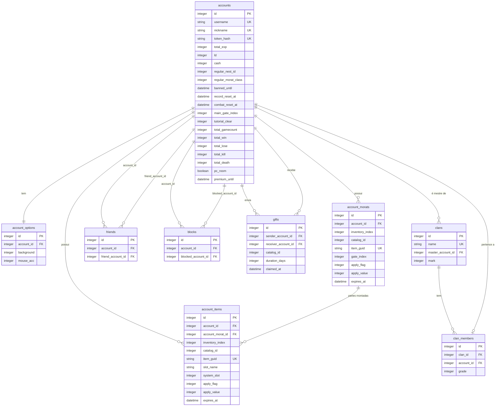

# Progressão e economia

Especificação do servidor para patente, experiência, moedas (LD e Cash), inventário, morats, loja, presente, gacha, tutorial, opções, amigos, bloqueios, clã e ranking.

Fora de escopo: a partida em si ([06-game-server-host.md](06-game-server-host.md)), salas, chat e penalidades de sala (ver §8). O banimento de conta entra (D106).

## 1. Convenções e fontes

- **Contrato com o cliente**: opcodes, layouts, ordem de bytes e comportamento observável. É o único ponto em que o servidor segue o legado ([D17](../decisions/README.md)).
- **(inferido)**: dedução sem evidência direta no cliente. Sem marca: visto no código do cliente, no `landmass.wdb` ou no legado.
- Evidências: [`re/features.md`](../../re/features.md) (citado por seção), [`re/channel_server.md`](../../re/channel_server.md) e [`re/message_server.md`](../../re/message_server.md) (opcodes e layouts), `landmass.wdb` (somente leitura, D7), dump UnrealScript de `LM_Engine.u`, `XInterface.u` e `XGame.u` (citado por função).
- Legado `LM_account.sql`: usado só como pista de regra de negócio. Nenhuma coluna ou procedure é copiada por ser legada.

## 2. Princípios do servidor

1. **Um processo `asyncio`** ([D1](../decisions/README.md)). Sem serviço auxiliar, sem link entre servidores, sem job de cópia.
2. **Serviços de domínio em memória** de instância única para o efêmero (presença, lobby, sala). **Persistência** por repositório SQLAlchemy atrás de `ports/`.
3. **Transação curta**: uma unidade de trabalho por pedido, aberta no handler e confirmada antes de enfileirar a resposta. Nenhum IO de rede dentro da transação.
4. **Regras no domínio**: funções Python puras, testáveis sem banco. O repositório só lê e grava. Nenhuma procedure, trigger ou função de banco.
5. **Estado de jogador é lido do banco a cada pedido**. Não há cache de inventário, saldo ou opções. O único cache é o catálogo estático ([D19](../decisions/README.md)).
6. **Economia serializada por conta**: `asyncio.Lock` por `account_id` em torno de compra, uso, destruição, extensão e presente. Débito por `UPDATE` condicional ([D20](../decisions/README.md)).
7. **Sem histórico**: nenhuma tabela de log, auditoria ou contador ([D12](../decisions/README.md)).

## 3. Legado: o que não é copiado

Cada linha registra a regra que sobrevive. O mecanismo do legado não é reproduzido.

| Legado | Tratamento no servidor | Regra resultante |
|--------|------------------------|------------------|
| `tbl_item_del`, `tbl_morats_del`, `tbl_friends_del`, `tbl_account_del`, `tbl_nickname_del` | `DELETE` na linha | Item destruído some. Sem histórico. |
| `tbl_loginlog`, `tbl_clanlog`, `tbl_logincount`, `tbl_usercount`, `tbl_concurrent`, `tbl_date_member`, `tbl_group_usercount` | Não migrar | Métricas sob demanda (D12). |
| `tbl_login`, `GameLogin`, `GameLogout`, `InsertLogIn` | Presença em memória da sessão | Online = conexão autenticada ativa. |
| `tbl_index` | `id` autoincremento | Sem gerador de IDs. |
| `tbl_account.item_number` com `InsertItem`/`DeleteItem`/`SaveItem` ajustando o contador | Contagem por consulta | Nenhum contador denormalizado. |
| `tbl_ranking` e `usp_renew_ranking` (job que recalcula cópia) | Consulta sobre `accounts` | Ranking em tempo real ([D18](../decisions/README.md)). |
| `SaveAccountInfo`, `SaveAccountInfoItem`, `SaveAccountNestRecord`, `SaveAccountRecord` (regravam o estado inteiro) | Atualização por campo, no repositório da conta | Grava só o que mudou. |
| `SavePointCash`, `SavePromotion`, `SavePromotionNest`, `SaveOperator`, `SaveEngineer`, `SaveCostume`, `SaveClanMasterLevel` | Operações de domínio | Saldo via serviço econômico (§5.1). Patente derivada, não gravada (§5.8). |
| `tbl_quickslot` | Migrada para `account_quick_slots` ([D73](../decisions/README.md)) | Cinco linhas por conta, semeadas na criação e em `account kit apply`. O cliente não tem opcode para ler ou gravar atalho (features §4): nada no protocolo a lê. |
| `tbl_temp_user`, `usp_insert_morats_temp`, `tbl_tool_patch` | Não migrar | Sem uso no cliente. |
| `tbl_option_list` | Não migrar | Descrições de opções não são lidas pelo servidor. |
| `ssn_first`, `ssn_second`, `userpw`, `userid` (cópia de login) | Não gravar CPF/SSN; login é `username`, senha é token | Privacidade e [authentication.md](../protocol/authentication.md). |
| `week_exp`, `month_exp`, `operator`, `engineer`, `promotion`, `oddeye_*`, `shadow_*`, `leon_*` | Não migrar no primeiro corte | Nenhum leitor no cliente. Por nest, ver dúvida 22. |
| `total_secedecount` | Não armazenar | Abandono é calculado pelo cliente (R-ABN, §5.13). |
| `tbl_penalty_list` | Não migrar | Penalidade de conta é `accounts.banned_until` (D106). Penalidade de sala segue em aberto (dúvida 21). |

## 4. Modelo de dados

### 4.1 Convenções

- Tipos portáveis ([04-persistence.md](04-persistence.md)): `Integer`, `String(n)`, `Boolean`, `DateTime(timezone=True)`.
- Toda tabela tem `id` (`Integer`, PK, autoincremento), `created_at` e `updated_at`.
- `catalog_id` (`Integer`, sem FK): id do cliente. No `landmass.wdb` (formato EAV), o id é a coluna `type` das tabelas `item` (consumíveis e skins), `Item_Equip` (equipamentos) e `Morats` (espécies). `Item_Equip.item_id` não é usada. Ver [D19](../decisions/README.md).
- `item_guid` (`String(36)`): UUID v4 gerado pelo servidor. O cliente identifica a unidade por ele (`LM_ITEM_INFO.strItemGuid`).
- `inventory_index` (`Integer`): índice por conta, o `siIdx` do cliente. É o menor índice livre na criação e só é reaproveitado após `DELETE` ([D22](../decisions/README.md)).
- Constraints e índices seguem `<tabela>_<coluna>_unique|index|foreign`; constraints compostas unem as colunas com `_`.

### 4.2 Diagrama

`account_options` tem 37 colunas `Integer` (§4.6); o diagrama mostra só duas. `catalog_id` referencia o catálogo estático e não aparece como entidade.

### 4.3 `accounts`: colunas novas

A tabela `accounts` existente ([04-persistence.md](04-persistence.md)) recebe as colunas abaixo. Padrão de todas: `0`, salvo indicação.

| Coluna | Tipo | Nulo | Origem | Uso |
|--------|------|------|--------|-----|
| `total_exp` | `Integer` | não | `tbl_account.total_exp`; `iTotalExp` | Experiência total. Fonte da patente (R-LVL). |
| `ld` | `Integer` | não | `tbl_account.point`; `iPoint` | Saldo de LD (`PointUnit`). ≥ 0 pelo `UPDATE` condicional (R-DEB). |
| `cash` | `Integer` | não | `tbl_account.cash`; `iCash` | Saldo de Cash (`CashUnit`). ≥ 0 pelo mesmo critério. |
| `regular_nest_id` | `Integer` | sim | `tbl_account.nest`; `ucNest` | Nest regular: 1 Oddeye, 2 Shadow, 3 Leon. |
| `regular_morat_class` | `Integer` | sim | (novo) | Classe regular: 1 a 4 (R-REG). |
| `banned_until` | `DateTime(tz)` | sim | (novo) | Fim do bloqueio administrativo (D106). Nulo ou no passado: login liberado. |
| `record_reset_at` | `DateTime` (fuso) | não | (novo, D131) | Marco de zerado de vitórias, derrotas e abandono (Queima de Arquivo). Nulo = nunca zerado. |
| `combat_reset_at` | `DateTime` (fuso) | não | (novo, D132) | Marco de zerado de abates, mortes e headshots (Reconstituir). Nulo = nunca zerado. |
| `main_gate_index` | `Integer` | sim | (novo) | Gate da morat principal, 0 a 7 (R-MAIN). |
| `gate_count` | `Integer` | não | (novo) | Gates da conta: 4 no início, +1 por Adicionar Hangar (308010005), até 8. Regra em R-GATE-01 (D95). |
| `tutorial_clear` | `Integer` | não | `tbl_account.tutorial_clear`; `iTutorialClear` | Máscara de bits do tutorial (R-TUT). |
| `total_gamecount` | `Integer` | não | `total_gamecount` | Partidas jogadas. |
| `total_win` | `Integer` | não | `total_win` | Vitórias. |
| `total_lose` | `Integer` | não | `total_lose` | Derrotas. |
| `total_kill` | `Integer` | não | `total_kill` | Abates. |
| `total_death` | `Integer` | não | `total_death` | Mortes. |
| `pc_room` | `Boolean` | não | `pc_room` | Jogador em sala de PC (bônus, R-REW-08). |
| `premium_until` | `DateTime(tz)` | sim | `premium_end` | Fim do premium (R-MON-05). |

`total_secedecount` não entra: o cliente calcula o abandono (R-ABN).

### 4.4 `account_items`

Inventário, implementado em F4. Uma linha por unidade ([D22](../decisions/README.md)). Índices de item começam em 1 ([D30](../decisions/README.md)). "Equipado" é derivado: `account_morat_id IS NOT NULL OR system_slot IS NOT NULL`. O gate de um item montado é o `gate_index` da morat dona.

| Coluna | Tipo | Nulo | Regra |
|--------|------|------|-------|
| `account_id` | `Integer` | não | FK `accounts.id`: `account_items_account_id_foreign`. |
| `inventory_index` | `Integer` | não | `siIdx`. Único por conta: `account_items_account_id_inventory_index_unique`. |
| `catalog_id` | `Integer` | não | Id do cliente (ex.: `201010001`). Sem FK (D19). |
| `item_guid` | `String(36)` | não | Único: `account_items_item_guid_unique`. |
| `account_morat_id` | `Integer` | sim | FK `account_morats.id`: `account_items_account_morat_id_foreign`. Preenchido quando é parte de uma morat. |
| `slot_name` | `String(20)` | sim | Slot dentro da morat (§5.4). Único por morat: `account_items_account_morat_id_slot_name_unique`. |
| `system_slot` | `Integer` | sim | 0 a 9 (`sEventSlot[10]`). Único por conta: `account_items_account_id_system_slot_unique`. |
| `apply_flag` | `Integer` | não | Enum `ITEM_APPLY` do cliente: 0 UNLIMIT, 1 SIZE, 2 REALTIME, 3 PLAYTIME, 4 ENABLE (inferido: pela ordem do enum). Padrão 0. |
| `apply_value` | `Integer` | sim | Usado por SIZE, PLAYTIME e ENABLE. Nulo em REALTIME. |
| `expires_at` | `DateTime(tz)` | sim | Usado por REALTIME. Nulo = não iniciado (contrato: `iApplyValue = 0`) ou sem prazo. |

Índice: `account_items_account_morat_id_index`. Destruir a morat zera `account_morat_id` e `slot_name` das partes na mesma transação ([D76](../decisions/README.md)). Não depende de `ON DELETE`, porque o SQLite não aplica chave estrangeira sem `PRAGMA foreign_keys`.

### 4.5 `account_morats`

Unidade de combate (espécie `SPECIES_*`), não moeda ([features §10](../../re/features.md)). Implementado em F5.

| Coluna | Tipo | Nulo | Regra |
|--------|------|------|-------|
| `account_id` | `Integer` | não | FK `accounts.id`: `account_morats_account_id_foreign`. |
| `inventory_index` | `Integer` | não | Igual ao `gate_index` (0 a 7), em namespace separado do item ([D30](../decisions/README.md)). Único por conta: `account_morats_account_id_inventory_index_unique`. |
| `catalog_id` | `Integer` | não | `Morats.id` (ex.: `101000001`). Sem FK. |
| `item_guid` | `String(36)` | não | Único: `account_morats_item_guid_unique`. |
| `gate_index` | `Integer` | sim | 0 a 7 (`sGate[8]`). Nulo = fora do gate. Único por conta: `account_morats_account_id_gate_index_unique`. |
| `apply_flag`, `apply_value`, `expires_at` | — | — | Iguais a `account_items`. |

### 4.6 `account_options`

Uma linha por conta (1:1). Guarda as 37 opções de `LM_REGISTER_INFO`, que o cliente envia em 544 (`SaveOption`) e recebe em 111 (`MS_REGISTER_OUT`, `@0x00..0x24`).

- Constraints: `account_options_account_id_unique` e `account_options_account_id_foreign`.
- Todas as colunas são `Integer`, `NOT NULL`, padrão `0`, faixa 0 a 255.
- O codec mapeia por índice `@i` (ordem fixa de [message_server.md §4.1](../../re/message_server.md)). A ordem é o contrato; os nomes são só do banco.

| `@i` | Coluna | `@i` | Coluna |
|-----:|--------|-----:|--------|
| 0 | `background` | 19 | `move_left` |
| 1 | `effect` | 20 | `move_right` |
| 2 | `voice_info` | 21 | `fire` |
| 3 | `voice_character` | 22 | `alt_fire` |
| 4 | `mouse_acc` | 23 | `walk` |
| 5 | `mouse_sensitivity` | 24 | `down` |
| 6 | `mouse_invert` | 25 | `jump` |
| 7 | `weapon_1` | 26 | `change_mag` |
| 8 | `weapon_2` | 27 | `chaff` |
| 9 | `weapon_3` | 28 | `booster` |
| 10 | `weapon_4` | 29 | `action` |
| 11 | `weapon_5` | 30 | `speech_menu_1` |
| 12 | `weapon_6` | 31 | `speech_menu_2` |
| 13 | `weapon_7` | 32 | `speech_menu_3` |
| 14 | `weapon_8` | 33 | `object` |
| 15 | `weapon_9` | 34 | `mirror` |
| 16 | `weapon_0` | 35 | `minimap` |
| 17 | `move_forward` | 36 | `screenshot` |
| 18 | `move_backward` | — | — |

Ao implementar, a tabela de índices do codec é a fonte de verdade. A conferência é feita por teste contra a captura.

### 4.7 `friends` e `blocks`

- `friends`: `account_id` e `friend_account_id` (FKs `friends_account_id_foreign` e `friends_friend_account_id_foreign`). Único: `friends_account_id_friend_account_id_unique`. Índice: `friends_friend_account_id_index`.
- `blocks`: mesma estrutura, com `blocked_account_id`. Único: `blocks_account_id_blocked_account_id_unique`. Índice: `blocks_blocked_account_id_index`.
- Relação direcional: adicionar B em A cria uma linha. (inferido: o cliente não tem pedido de confirmação.)
- Migração `ce9926b0fcad` (F12), sobre `31c91374dcba`. Chave do amigo: o `account_id` do alvo, o mesmo id que o cliente devolve em 182 e 187.
- Sem `last_seen_at`: o log de amigo (`NotifyFriendLog`) não tem opcode (dúvida 16).

### 4.8 `clans` e `clan_members`

- `clans`: `name` (`String(16)`, único: `clans_name_unique`), `master_account_id` (FK `clans_master_account_id_foreign`) e `mark` (`Integer`, id do ícone; `clan_mark`).
- `clan_members`: `clan_id` (FK `clan_members_clan_id_foreign`, índice `clan_members_clan_id_index`), `account_id` (FK `clan_members_account_id_foreign`, único `clan_members_account_id_unique`: uma conta, um clã) e `grade` (`Integer`, `member_grade`).
- Não há `clan_logs`. O legado `tbl_clanlog` é log (D12).
- Migração `3f8a1c0d9e27` (F13), sobre `ce9926b0fcad`. Uma conta, um clã (D60). O mestre entra como membro de grau 0 (D61).

### 4.9 `gifts`

Presente pendente. Linha criada no envio (615); `claimed_at` nulo = pendente, e o resgate marca a data sem apagar a linha. A compra direta de item não passa por aqui: vai ao hangar (D96). Migração `a3d9e6f1c402`.

| Coluna | Tipo | Nulo | Regra |
|--------|------|------|-------|
| `id` | `Integer` PK | não | Chave da linha. O `item_guid` do resgate sai dela (`gift-<id>`). |
| `sender_account_id` | `Integer` | sim | FK `gifts_sender_account_id_foreign`. Remetente. |
| `receiver_account_id` | `Integer` | não | FK `gifts_receiver_account_id_foreign`. Índice `gifts_receiver_account_id_index`. |
| `slot` | `Integer` | não | Chave u16 que o cliente devolve no 612. Menor livre entre os pendentes do destinatário (D97); a regra fica no envio, sem constraint. |
| `catalog_id` | `Integer` | não | Id do cliente. Sem FK. |
| `duration_days` | `Integer` | não | Prazo da opção: 1, 7, 14 ou 30 (R-PRC-01). |
| `claimed_at` | `DateTime(tz)` | sim | Nulo = pendente. |
| `created_at`, `updated_at` | `DateTime(tz)` | não | Datas da linha. |

### 4.10 Ranking: sem tabela

Decisão em [D18](../decisions/README.md). A lista é consulta sobre `accounts`:

- Ordem: `total_exp` decrescente.
- Empate: todos recebem a menor posição do grupo (1, 1, 3, ...).
- Limite: 100 linhas (o laço do cliente para em 100; `MAX_LANK_LIST` não localizado).
- Sem cache. O volume é de dezenas de contas por canal; se a consulta pesar, o índice `accounts_total_exp_index` resolve antes de qualquer cache.

Justificativa: o legado mantinha `tbl_ranking` por job (`usp_renew_ranking`), uma cópia derivada que D12 não admite. O cliente só lê a lista; não há escrita a sincronizar.

Implementado em F14: `domain/ranking.py` (posições) e `db/ranking.py` (consulta, com `outerjoin` em `clan_members` para o id do clã). Ranking por nest não cabe no protocolo: 170 não tem corpo e 171 não tem campo de nest (D56, D108, dúvida 22).

### 4.11 `shop_items`

Venda da loja (D191). Uma linha por id do catálogo que se vende. `landmass-emu shop sync` a preenche a partir do wdb; tabela vazia = nada à venda. A compra lê a linha a cada pedido, sem cache.

| Coluna | Tipo | Nulo | Regra |
|--------|------|------|-------|
| `catalog_id` | `Integer` | não | Chave primária. Id do catálogo do cliente. Sem FK (D19). |
| `name` | `String(64)` | não | Nome exibido: `item_name` (item e Item_Equip) ou `alias` (Morats), em cp1252. |
| `enabled` | `Boolean` | não | Falso recusa a compra (R-BUY-07). O `sync` não altera o valor de quem já existe. |
| `point_0` a `point_3` | `Integer` | não | Preço em LD por nível (0 a 3). Zero = não vendido em LD. Morat usa só o nível 0, já com o ×5 de R-PRC-03. |
| `cash_0` a `cash_3` | `Integer` | não | Preço em Cash por nível. Mesma regra. |
| `created_at`, `updated_at` | `DateTime(tz)` | não | Convenção do projeto. |

Migração `e8b4d1f6a237` (sobre `5c1e8a3f7b92`). Modelo `ShopItemRow` em `db/models.py`.

## 5. Regras de negócio

Ids `R-*` para referência em testes e na ordem de implementação (§7). Fonte: seção de [features.md](../../re/features.md) ou função/linha do dump.

### 5.1 Moedas e saldo

| Id | Regra | Fonte |
|----|-------|-------|
| R-MON-01 | LD (`PointUnit`) é `accounts.ld`. Cash (`CashUnit`) é `accounts.cash`. Ambos são inteiros ≥ 0. | features §11; `localize` |
| R-DEB-01 | Compra, extensão e presente debitam por `UPDATE accounts SET ld = ld - :p WHERE id = :id AND ld >= :p` (ou `cash`), na mesma transação que cria a linha de item. `rowcount = 0` é saldo insuficiente, e nada é gravado. | (inferido; D20) |
| R-MON-02 | Não há pedido de carga no cliente. LD e Cash entram por recompensa de partida (LD) e por comando de administração (CLI nova `account grant`). | features §11 (inferido) |
| R-MON-03 | Após qualquer mudança de saldo, o canal envia `902` (LD) e/ou `900` (Cash) à conta conectada. Os pushes são a única forma de o cliente atualizar `iPoint` e `iCash`. | features §11 (`OnChargePoint`, `OnChargeCash`) |
| R-MON-04 | Premium: `premium_until` é a data de fim. Enquanto válido, o cliente mostra o estado premium. O push `901` atualiza o cliente. | features §11 (`NotifyChargePremium`) |
| R-MON-05 | Bônus de PC-room é aplicado só a jogadores com `pc_room`. | features §11; `XGame` |

### 5.2 Catálogo e preço

| Id | Regra | Fonte |
|----|-------|-------|
| R-CAT-01 | Grupo = `id / 1e8` (0 nenhum, 1 morat, 2 equipamento, 3 item, 4 efeito). Classe = `(id / 1e6) % 100`. Tipo = `(id / 1e4) % 100`. Índice = `id % 1e4`. | features §0.3 (`GetItemClassify`) |
| R-CAT-02 | Catálogo em memória: `item` (14 ids: consumíveis e skins), `Item_Equip` (61 ids), `Morats` (9 espécies), `GameRewardConstant` (47 chaves), `LevelList` (101 níveis), `gift` (3 pacotes de sistema). O wdb dá nome, requisito e tipo. A venda (habilitado e preço) é de `shop_items` (§4.11, R-BUY-07). | `landmass.wdb`; D191 |
| R-PRC-01 | Preço por opção `i` de 0 a 3: duração 1, 7, 14 e 30 dias (`BUY_OPTION1/7/14/30`). Preço em LD é `point_i` de `shop_items`; em Cash, `cash_i`. A tabela sai do wdb (`item_buy_point[i]`, `item_buy_cash[i]`) pelo `shop sync` (D191). Preço zero na moeda escolhida = não vendido nela. | features §2.2; `XInterface` `InternalOnClose` 12160–12232; D191 |
| R-PRC-02 | Opções 8 e 9 chegam como `nBuyOption = 0`, com `bPoint` igual a true (8, LD) ou false (9, Cash). O pacote não distingue. Tratar como opção 0 (1 dia). | features §2.2 (inferido; dúvida 4) |
| R-PRC-03 | Morat: a UI envia `ItemBuy(id_especie, true, 1)` fixo, com `FIXME` que mapeia 1→0. A UI exibe e valida `nPoint[0] × 5` (inferido: índice 0). O servidor cobra `point_0` de `shop_items`, que o `shop sync` grava como `buy_point[0] × 5`, e ignora a opção (D51, D191). | `XInterface` `LM_SupplyMoratsBuyPopPage` 9188–9258; dúvida 1, resolvida; D191 |

### 5.3 Compra (550, 551 e 552)

| Id | Regra | Fonte |
|----|-------|-------|
| R-BUY-01 | Ordem de validação (`ShopService`): conta autenticada (sem login, não responde); `catalog_id` no catálogo; linha em `shop_items` habilitada (R-BUY-07); preço > 0 na moeda e opção, da tabela; saldo; patente e nest (R-REQ); gate livre (morat). Qualquer falha recusa e não grava. | (inferido; D51; D191) |
| R-REQ-01 | Requisitos: `item_required_level`, `item_required_nest`, `item_required_nest_point`, `item_required_clan`, `item_required_clan_rank`, `item_required_rank`, `item_required_class`, `item_required_strength`, `item_required_agility`, `item_required_precision` e `item_required_power`; para morat, `required_*`. Conferidos na compra: `required_level` (patente pela LevelList) e `required_nest` (nest regular). Recusam se ≠ 0, sem fonte no servidor: `nest_point`, clã, patente de clã e `rank`. Classe, força, agilidade, precisão e energia são de equipar (F6): a tela de morat não as usa para bloquear a compra. | features §2.2; dúvida 10, resolvida (D51) |
| R-BUY-02 | Item: `account_items` com `apply_flag = 2` (REALTIME) e `expires_at = agora + dias`, com os dias da opção 0 a 3 (1, 7, 14 ou 30). Morat: `account_morats` no menor gate livre e habilitado (R-GATE-02), sem prazo. O cliente não escolhe o gate na compra. | (inferido; dúvidas 5 e 19; D51) |
| R-BUY-03 | Resposta 551 (item) ou 552 (morat) com `result`. Sucesso: registro (102 ou 103), depois 900 e 902. Só com `result` 0 o cliente aplica registro e saldos. Recusas: -4056 (LD insuficiente, msg 231000602), -4055 (Cash insuficiente, 231000502), -1 (sem gate livre habilitado, 231000802) e 8000 (sem mensagem: fora do catálogo, sem linha habilitada em `shop_items`, não vendido na moeda ou requisito não atendido). Morat recusado sai com 552 mesmo quando a recusa vem da tabela. | `NotifyItemBuy` (XInterface, `switch`); `ERRCODE_*` inferidos iguais aos `CERR_BUY_*` (D51); D191 |
| R-BUY-04 | Cada compra gera `item_guid` novo e `inventory_index` livre da conta. Nenhuma linha parcial sobrevive a falha (transação). | (inferido; D22) |
| R-BUY-05 | Catálogo abre na primeira compra (`LazyItemCatalog`), então o canal sobe sem o wdb. Enquanto o wdb não abre, a compra é recusada com 8000 e erro no log. Emenda a D19 (D50). Tabela `shop_items` vazia: nada à venda (8000 em toda compra); a subida registra aviso para rodar `shop sync` (D191). | (inferido; D191) |
| R-BUY-06 | Item comprado vai direto ao hangar. A msg 231000104 diz "vá até o Depósito"; o servidor não manda ao Depósito (D96). Risco aberto: o texto da tela não bate com o destino. | `msg_error` 231000104; D96 |
| R-BUY-07 | Venda: `shop_items` (§4.11) é a única fonte de habilitado e de preço da compra (550). `shop sync` importa do wdb as vendas com preço > 0 em alguma moeda e opção (o que `quote` aceita), com nome e preço; grava nome e preço de quem já existe e mantém `enabled`. `shop enable`, `disable` e `price` mudam a tabela, e a compra lê a linha a cada pedido, sem reiniciar. Presente (615) e extensão (580) ainda cobram o preço do wdb: não passam por `shop_items`, então item desativado segue vendável por esses caminhos (aberto). | D191 |

### 5.4 Uso, gate e slots de sistema (560, 570, 573)

| Id | Regra | Fonte |
|----|-------|-------|
| R-USE-01 | `ItemUsed(index, gate)` (560, corpo de 8 bytes: `u16 index` @0, `u16 gate` @2, `i32 value` @4): item com `inventory_index = index` é montado no gate `gate` (0 a 7). Peça (`Item_Equip`, grupo 2) vira `account_items.account_morat_id` da morat do gate, com `slot_name` pelo `item_slot` (D70; dúvida 9 resolvida). A resposta 562 leva gate, índice e slot. Gate sem morat responde 561 com -1. Morat (grupo 1) não entra por 560: recusa com -4. Pintura (classe 7) monta em `skin_00` (R-SKIN-01). | features §3.2 (inferido nos detalhes) |
| R-USE-02 | Gates: 8 por jogador (`sGate[8]`, `LM_GATE_SLOT`: `siIdx`, `bEnable`). Slots de sistema: 10 (`sEventSlot[10]`). | `LM_Engine.u` `LM_PLAYER_INFO` |
| R-USE-03 | Slots de `slot_name` (de `LM_MORATS_INFO`): `main_weapon`, `sub_weapon`, `melee_weapon`, `etc_weapon_00..02`, `booster`, `generator`, `head`, `body`, `arm`, `leg`, `etc_item_00..03` e as skins `skin_00..02` (`siSkinID[3]`, D136). | `LM_Engine.u` `LM_MORATS_INFO` |
| R-USE-04 | Item de sistema (grupo 3, classe 8) vai para `system_slot` livre, de 0 a 9 (554 leva o slot). Sem slot livre, recusa com -4 (D74). Fica no slot até ser destruído (559 libera). Tipo pelo id (D130): BUFF (tipo 2) fica no slot até o prazo (R-BUFF-01); ONCE (Queima de Arquivo, Reconstituir, Alistar e Troca de Função) é consumido (R-CON-01 a 04). Adicionar Hangar e Item Surpresa, também ONCE, não montam: o 560 os usa (R-USE-08). | features §0.3, §3.2 (inferido nos detalhes) |
| R-USE-05 | `ItemUnused(index, gate)` (570, corpo de 4 bytes: `u16 index` @0, `u16 gate` @2) remove a peça: zera `account_morat_id` e `slot_name`, e responde 572 com gate e slot. Item de sistema não desmonta por 570: recusa com -4 (D74). | `channel_server.md` §2; dúvida 8 (resolvida, `re/protocol_full.md` §9) |
| R-USE-06 | Morat principal: `ItemUsedByValue` (560 com `value` ≠ 0) existe no wrapper `0x10018260`, fora dos consumíveis, o F6 o recusa com 561 e -4 (D75). A troca de morat principal entra só pelo consumível Troca de Função (R-CON-04); `main_gate_index` não é escrito. | features §3.2; dúvida 7 |
| R-USE-07 | Usar item que não pertence à conta, ou item já montado no mesmo slot, responde erro sem alterar nada. | (inferido) |
| R-USE-08 | `ItemUsed` (560) com item especial não equipa: `308010006` (Item Surpresa) abre o gacha (R-GACHA-01) e `308010005` (Adicionar Hangar) sobe `gate_count` (R-GATE-01). Montado, de sistema ou vencido segue para o equipar, que recusa (vencido: -4). | D98, D99 |
| R-GATE-01 | Gates habilitados no 101 (`bEnable`, `sGate[g]`): `min(max(gate_count, maior gate ocupado + 1), 8)`, com `gate_count` padrão 4. Sobe 1 por Adicionar Hangar, até 8. Morat em gate 5 mantém o gate 5 habilitado mesmo com `gate_count` 4. | LM_Engine.src L1002; `enabled_gates`; D95 (inferido) |
| R-GATE-02 | Morat comprado entra só no menor gate livre e habilitado. Sem vaga, NO_SPACE (-1), sem débito. O cliente não escolhe gate. | `ShopService._new_unit`; D96 (inferido) |

### 5.5 Destruição e extensão (555, 556, 580, 582, 585)

| Id | Regra | Fonte |
|----|-------|-------|
| R-DEST-01 | `ItemDestroy(id, index)` (555: `i32 id` @0, `u16 index` @4) remove a linha por `DELETE`, sem histórico (D12). A resposta 556 leva o gate do morat (`u16 gate` @2) e `u8 mounted` @4, para o cliente tirar a peça. Item de sistema responde 559 com o slot. | features §3.3; `re/protocol_full.md` §9 |
| R-DEST-02 | Destruir morat (557) zera as peças em `account_items` (`account_morat_id` e `slot_name`) e apaga a linha, na mesma transação (D76). Não destrói o último morat da conta (D69): recusa com -4. | (inferido); D69, D76 |
| R-EXT-01 | `ItemExtend` (580: `i32 id` @0, `u16 index` @4, `u8 point` @6, `u8 option` @7) usa o preço e o prazo da tabela de compra (R-PRC-01). Se `expires_at` está no futuro, soma os dias a partir dele; se é nulo ou vencido, parte de agora (D71). Morat não tem prazo: recusa com -4. Saldo insuficiente recusa com o código de D51 e nada é debitado (D72). O preço hoje é o do wdb, não o de `shop_items` (aberto, R-BUY-07). | features §3.3; (inferido) |
| R-EXT-02 | Resposta 582 (`NotifyItemExtend`): `u16 index` @0; `i32 apply_value` @4 (fim do prazo em segundos Unix, REALTIME); `i32 cash` @8; `i32 point` @0xc; `i32 result` @0x10. A extensão de morat (581) não é emitida. | features §3.3; `re/protocol_full.md` §9 |
| R-EXP-01 | Item REALTIME com `expires_at <= agora` gera o push `585` (`NotifyItemEndtime(nIndex, bItem, premium)`), que abre a tela de renovação. O item fica até renovação ou destruição. No login, item vencido recebe 585 com `bItem` = 1 (F7). Remoção automática não definida (dúvida 5). | features §3.3 (inferido nos detalhes) |
| R-VAL-01 | `apply_value` por flag: REALTIME usa `expires_at` (inferido: `apply_value` com segundos absolutos, `0` quando `expires_at` é nulo); SIZE, PLAYTIME e ENABLE usam `apply_value` direto. | `LM_Engine.u` `ITEM_APPLY`; `XInterface` 36788–36798 (inferido nos valores) |

### 5.6 Presente (615, 616, 610, 611, 612, 613)

| Id | Regra | Fonte |
|----|-------|-------|
| R-GIFT-01 | Envio (615): o remetente paga pela tabela de R-PRC-01 na moeda e opção pedidas. O preço ainda é o do wdb, não o de `shop_items` (aberto, R-BUY-07). Cria `gifts` pendente e debita o remetente na mesma transação (D20, D97). Nick inexistente responde -2407. Envio a si mesmo, morat, item não vendido na moeda ou opção fora de 0 a 3 responde 8000 (sem mensagem). Saldo insuficiente responde -4056 (LD) ou -4055 (Cash). Resposta 616: `result`, Cash e LD do remetente. | features §2.3; `NotifyItemGift` (XInterface, `switch`); códigos de nick e saldo inferidos de `CERR_*` (D97) |
| R-GIFT-02 | Patente mínima: nenhuma. `LevelList` tem `enable_gift` no nível 0 e `EnableGiftExp = -1`, então a checagem do cliente nunca dispara. O servidor não impõe patente (dúvida 2, resolvida, D97). | `XInterface` 12022, 22970; `LevelList` (wdb) |
| R-GIFT-03 | Depósito (610): página de 12 presentes pendentes do destinatário, por `slot`; página de 0 a n. Antes de listar, resgata os pendentes (D100): cada um vira 102 no hangar e sai da lista; a página sai vazia, salvo o que não coube. Resposta 611: `i32` página @0, `i32` quantidade @4 e registros de 0x48 a partir de @8 (`u16` chave @0, `i32` catálogo @0x14, `item_guid` `gift-<id>` @0x18, `u8` opção de prazo @0x40). Lista vazia manda um registro zerado, com quantidade 0. | `NotifyGetGiftItem` (L1483–1522); D97 |
| R-GIFT-04 | Resgate (612 → 613): pede a chave do pendente. O cliente não envia 612 na UI: o 610 faz o mesmo resgate (D100). Na mesma transação o servidor cria a unidade no menor índice livre, grava no hangar e marca `claimed_at`. A 613 leva o registro do item em @0..0x33, `i32` resultado @0x34 e a chave em @0x38, que o cliente usa para tirar a entrada do Depósito. Com resultado diferente de 0, o registro sai zerado. Pendente inexistente ou já resgatado responde 8000. Índice ocupado desfaz tudo: o presente continua pendente. **Sem chamador de UI confirmado:** o XInterface não chama `GiftItemUsed` (só o wrapper de `LM_Engine.src`, L1892), e a classe do painel do Depósito (`LM_HangerSupplyInvenListPanel`) não está no dump. Risco 1 (D97). | `NotifyGiftItemUsed` e dispatcher 0x265 (L1526–1561); `GiftItemUsed` (`LM_Engine.src` L1892); dúvida 3 aberta |
| R-GIFT-05 | Pacotes `gift` do wdb (`gift_okcashback1..3`) são itens de sistema com `item_id`, `apply_flag` e `apply_value`. Quem os concede não aparece no cliente. | `landmass.wdb` `gift` (inferido: concessão pelo servidor) |
| R-GIFT-06 | Aviso (617): vai ao destinatário online quando o envio é gravado, sem corpo. Offline, vê o presente ao abrir o Depósito. | `NotifyGetGift` (L1626–1629); D97 |

### 5.7 Gacha (591)

| Id | Regra | Fonte |
|----|-------|-------|
| R-GACHA-01 | `ItemUsed` (560) com `308010006` ("Item Surpresa", ONCE) consome o item e sai 591: `u16` chave (índice consumido) @0, `i32` quantidade @4, `i32` resultado @8 e registros `GACHA_PRIZE` de 0x110 bytes a partir de @0xC (`i32` item_id, `i32` size, `i32` buy_option, texto UTF-8 NUL nos bytes restantes). Até 2 prêmios, como o laço do dispatcher. Depois saem 102 de cada item novo, 900 e 902 (D98). | features §2.4; `NotifyGetGatchaPrize` (L2749–2771); tamanho de 0x110 inferido |
| R-GACHA-02 | Prêmio LD (`item_id` 0) soma em `accounts.ld` na mesma transação que consome o item. Prêmio de item vai para `account_items` com o prazo do sorteio (R-BUY-02). Consumo que falha responde -4 e nada é creditado (D98). | features §2.4; D20 |
| R-GACHA-03 | Pool: os 12 itens de `Item_Equip` com `item_buy_type` 1 e preço 0 (201020001, 201040002, 201120001, 201140001, 204010003, 204010004, 204020003, 204020004, 204030003, 204030004, 204040003, 204040004), prazo de 1 dia. Chances iguais: LD sempre, e um prêmio de sorte entre cinco opções (três pinturas, EXP+ e a caixa). | features §2.4; D98 (decisão, não vem do cliente) |
| R-GACHA-04 | Faixa de LD: 1.000 a 500.000, passo 1.000, pela descrição do item (`XGame.LM_EtcItemI`). Inferido: pode ser generosa; confirmar com o usuário. | D98 (inferido) |

### 5.8 Experiência e patente

| Id | Regra | Fonte |
|----|-------|-------|
| R-LVL-01 | Patente (nível) = maior `n` tal que `total_exp >= LevelList.exp[n]`. Nível 0 tem `exp = -1`, e nível 1 ("Novato") começa em 0. Máximo: nível 100. | `LM_Engine.u` `GetLevelInfo` (dump, função estática) e `PrecessLevelList` |
| R-LVL-02 | A patente não é coluna (D21). Nome do nível: `LevelList.levelname`. | D21 |
| R-LVL-03 | Progresso exibido pelo cliente: `(exp − exp[n]) / (exp[n+1] − exp[n])`. O servidor envia só `total_exp`. | `GetLevelInfo` (`ExpPer`) |
| R-LVL-04 | Níveis 95 a 100 têm `exp = 2147483647`: inalcançáveis na prática. | `landmass.wdb` `LevelList` |
| R-LVL-05 | Nível "Praça" (nível 2, `exp = 2800`) é marcado `select_nest`. O cliente não lê `SelectNestExp` em nenhuma tela (só é declarado). Exigir esse nível para `SetRegular` é proposta, não regra do cliente (dúvida 11). | `PrecessLevelList`; grep em `XInterface` e `XGame` |
| R-LVL-06 | Não há mensagem de "subiu de patente". O cliente recalcula pelo `total_exp` recebido. | (inferido) |

### 5.9 Recompensa de partida

Cálculo por jogador, no fim da partida. Constantes de `GameRewardConstant` (valores no wdb, não copiados no banco). Entradas de cada modo: kills, takes, rodadas, pontuação de meta, ranking e NumPlayers, todos vindos da partida (marco 4).

| Id | Regra | Fonte |
|----|-------|-------|
| R-REW-01 | **DM**: `matchExp = GoalScore / DM_MatchExp` se `NumPlayers >= 6`; senão `GoalScore / (DM_MatchExp / (NumPlayers / MaxPlayers))`. | `XGame` cálculo DM (~16205–16216) |
| R-REW-02 | **DM exp**: `killExp = kills × DM_KillExp`; `takeExp = matchExp × DM_TakeExp × (maxKills / GoalScore) × playRate`; `winExp = matchExp × DM_WinExp × (maxKills / GoalScore)`, multiplicado por `DM_RankBonusExp_1` (1º), `_2` (até 5%), `_3` (10%), `_4` (15%), `_5` (20%), `_6` (30%); zero acima de 30%. `exp = killExp + takeExp + winExp`. | `XGame` ~16231–16260 |
| R-REW-03 | **DM LD**: `killMoney = killExp × DM_KillPoint`; `takeMoney = takeExp × DM_TakePoint`; `winMoney = winExp × DM_WinPoint`. `money = soma`. | `XGame` ~16262–16275 |
| R-REW-04 | **OP exp**: `matchExp = (rodadasVencedor × OP_MatchExp_1) / OP_MatchExp_2` (com ajuste igual ao de DM para `NumPlayers < 6`). `killExp = kills × OP_KillExp`; `takeExp = matchExp × OP_TakeExp × playRate`; `winExp = matchExp × OP_WinExp × playRate` só para o time vencedor; `missionBonusExp = serviceScore × OP_MissionBonusExp`. `exp = soma`. | `XGame` `LM_TeamOperation` ~6520–6584 |
| R-REW-05 | **OP LD**: `killMoney = killExp × OP_KillPoint`; `takeMoney = takeExp × OP_TakePoint`; `winMoney = winExp × OP_WinPoint`; `missionBonusMoney = missionBonusExp × OP_MissionBonusPoint`. `money = soma`. | `XGame` ~6586–6604 |
| R-REW-06 | **TDM e BR**: constantes existem (`TDM_*`, `BR_*`); as fórmulas não foram lidas nesta revisão. Lacuna (dúvida 14). | features §1.2 |
| R-REW-07 | `playRate` tem duas definições: DM usa tempo (`(ElapsedTime − StartTime) / ElapsedTime`, ~16349); OP usa rodadas (`JoinRound`, ~6698). Cada modo usa a sua. | `XGame` (dúvida 14) |
| R-REW-08 | Ordem após o cálculo base: (1) `× ExpMult` e `× MoneyMult` se > 0 (ambos 1); (2) bônus PC-room com `pc_room`: `exp += exp × PCRoomBonusExp` e `money += money × PCRoomBonusPoint` (valor 1 = +100%, inferido); (3) bônus de evento: `exp += exp × BonusExpMult` e `money += money × BonusMoneyMult` (origem não localizada); (4) buffs: `exp × 1.5` se `bExpIncrement` (item `308020001`) e `money × 1.5` se `bLDIncrement` (item `308020002`). | `XGame` 6625–6640, 16296–16311; `ApplySysItmValue` 16852 |
| R-REW-09 | Tipo de vitória: time vencedor (OP e TDM) ou ranking 1 (DM). Não há campo de vitória no cliente; a regra é (inferido). | (inferido) |
| R-REW-10 | Gravação: uma transação por partida que soma `total_exp` e `ld` de cada jogador com dado (D155). `total_gamecount`, `total_win`, `total_lose`, `total_kill` e `total_death` não são somados: a ficha lê `match_players` (D107). Os valores float são convertidos para inteiro (regra de arredondamento: dúvida 13). | (inferido; D20) |
| R-REW-11 | O resultado do DM não passa por GS_*. Sai no bloco `GameEnded` do log, lido ao fim da partida (D153, D154). Quem grava exp e LD na conta é `SqlMatchRepository.save` (D155). | `re/game_server_host.md` §11 |

### 5.10 Tutorial (600, 601)

| Id | Regra | Fonte |
|----|-------|-------|
| R-TUT-01 | Três passos (movimento, tiro e engenheiro). Pedido `ClearTutorial(u8 índice)`, com índice 0 a 2. Bit = `1 << índice` (`0x1`, `0x2`, `0x4`) (inferido pela máscara do cliente). Operação é OR no campo, idempotente. | features §1.1 (`iTutorialClear & 0x0001/0x0002/0x0004`) |
| R-TUT-02 | O cliente só envia o passo quando o bit não está marcado (`LM_TutorialCompletePage`, 6080–6125). | features §1.1 |
| R-TUT-03 | Resposta com `Tutorial`, `Point` e `Result` (`NotifyTutorialClear`). Código de resposta não atribuído: o bloco 902 é misto (dúvida 15). | features §1.1; `channel_server.md` §3.2 |
| R-TUT-04 | Não há recompensa de tutorial no cliente (features §1.1). Nenhuma recompensa é concedida (inferido). | features §1.1 |

### 5.11 Morats regulares (105, 104)

| Id | Regra | Fonte |
|----|-------|-------|
| R-REG-01 | `SetRegular(nest, classe)`: `nest` ∈ {1, 2, 3} (Oddeye, Shadow, Leon); `classe` ∈ {1 ASSAULT, 2 SNIPER, 3 DEFENDER, 4 ENGINEER}. A classe 5 (SPECIAL) não é selecionável. | `LM_Engine.u` `SetRegular` 1843–1851; features §10 |
| R-REG-02 | Grava `regular_nest_id` e `regular_morat_class`. Resposta `104` (`NotifySetRegular`). | features §10 |
| R-REG-03 | Mesmo gate não recebe dois morats (`account_morats_account_id_gate_index_unique`). | (inferido) |

### 5.12 Opções (544, 111)

| Id | Regra | Fonte |
|----|-------|-------|
| R-OPT-01 | `SaveOption` (544) grava as 37 opções de `account_options` (corpo de 37 bytes). Sem resposta conhecida. | `channel_server.md` §2 (544) |
| R-OPT-02 | `Register` (110 → 111) devolve as 37 opções gravadas em `@0x00..0x24`. Conta sem registro recebe as teclas e a sensibilidade padrão (D140, D172). Implementado (F1). | `message_server.md` §4 (111) |
| R-OPT-03 | Valor padrão de conta nova: teclas do `[Engine.Input]` do `User.ini` do cliente (`KeyBindDefaults`, D140) e sensibilidade do mouse 8 (`MouseDefaults`, D172); inverter, voz e volume ficam em 0, sem fonte (D173). | re/game_server_host.md §12 e §13 (inferido) |

### 5.13 Social, clã e abandono

| Id | Regra | Fonte |
|----|-------|-------|
| R-SOC-01 | Amigos: 180 responde 183 por amigo e 188 por bloqueado (lista vazia: nada). 181 cria a linha por nick e responde 183 com o registro. 182 remove pelo id e responde 184. 190 responde 191 só com os ids da própria lista. Pedido recusado responde registro de id 0 com `result` -11 (D35). | `protocol/message-server.md`; `re/protocol_full.md` §2 |
| R-SOC-02 | Bloqueio: 186 cria por nick e responde 188; 187 remove pelo id e responde 189; 192 responde 193 só com os ids da própria lista. Layouts de 181, 182, 186 e 187 medidos nos wrappers (dúvida 16). O bloqueio só tem efeito no sussurro (R-SOC-04, D38). | `protocol/message-server.md`; `re/protocol_full.md` §2 |
| R-SOC-03 | Limite de amigos e de bloqueados: não localizado (dúvida 17). | — |
| R-SOC-04 | Sussurro (160): 161 vai só ao destinatário conectado no Message, sem confirmação ao remetente. Destinatário fora do Message, ou que bloqueou o remetente: 162 com -19. Nick inexistente: 162 com -11 (D36). | `protocol/message-server.md` |
| R-SOC-05 | Presença: online = conexão autenticada no Message (D32). Sem aviso de entrada e saída, pois não há opcode: o estado vem nas consultas 180, 190 e 192 (D39). | `protocol/message-server.md` |
| R-CLAN-01 | Criar, entrar e sair de clã não existem no cliente. Clãs e membros são criados pela CLI `landmass-emu clan` (inferido, mesma regra de D10; D55). | features §7 |
| R-CLAN-02 | No login, `NotifyInMessageServer` (121) traz `clan_code = clans.id` quando a conta tem clã. Com clã, o cliente pede dados (171) e membros (174). Mudança de clã aparece no próximo login (D27, D55). | features §0.1, §7 |
| R-CLAN-03 | Chat de clã só para membros (`clan_code > 0`). | features §5.3 |
| R-CLAN-04 | Chat de clã (177 → 178) vai a todos os membros online, inclusive a quem enviou. Quem não tem clã não envia (D58, inferido). | features §5.3 |
| R-CLAN-05 | Uma conta, um clã; nome único de 1 a 16 caracteres (D60). O mestre não sai enquanto houver outros membros; o último a sair apaga o clã (D59, shortcut). | D59, D60 |
| R-ABN | Abandono = `(total_gamecount − total_win − total_lose) × 100 / total_gamecount`. Calculado pelo cliente a partir de jogos, vitórias e derrotas que a ficha recebe (D105, D107). Não há coluna. | features §12 (`OnDetailPlayerInfo`, 32813) |
| R-PEN-01 | Banimento de conta: `account ban` grava `accounts.banned_until`; o login recusa com `-160` até o prazo vencer. `account unban` zera. Não há penalidade automática por abandono (o cliente não tem tela para isso). | D106, features §12 |
| R-FIC-01 | Ficha (542/543): nick, posição, exp, nest e clã vêm do banco. Jogos, vitórias, derrotas, abates, mortes e headshots saem zero até haver resultado e métricas gravadas (D105, dúvida 17). | D107 |
| R-RNK-01 | Ranking por nest fica fora: 170 não tem corpo e 171 não tem campo de nest. | D108, dúvida 22 |

## 6. Mapeamento opcode → caso de uso → tabelas

Estado atual: os opcodes desta seção não são tratados hoje. Tratados (ver [channel-server.md](../protocol/channel-server.md) e [message-server.md](../protocol/message-server.md)): Channel 2, 100, 101, 111, 120–123, 141, 151 (lobby), 240, 241, 544 (F1), 600, 601, 900, 902 (F2 e F3), 591 e 610 a 617 (F10 e F11); Message 2, 100, 101, 110, 111, 120, 121, 130, 131, 160–162, 180–193 (F12).

Legenda de layout: **completo** = campos nomeados; **parcial** = tamanho ou alguns campos; **falta** = só o nome.

### 6.1 Channel (porta 7314)

| Opcode | Direção | Caso de uso | Tabelas | Layout (re) | Estado |
|-------:|:-------:|-------------|---------|-------------|--------|
| 102 | S→C (push) | Lista de itens da conta | `account_items` | parcial: `u16 @0` chave, zerar `@0x35` ([layouts_f0 §8](../../re/layouts_f0.md)) | implementado (F4, no login) |
| 103 | S→C (push) | Lista de morats com gate | `account_morats` | parcial: `u16 @0` gate, `u8 @0x5d`, registro de 92 bytes ([layouts_f0 §8](../../re/layouts_f0.md)) | implementado (F5, no login) |
| 104 | S→C | Resposta de `SetRegular` | `accounts` | corpo vazio | implementado (F5) |
| 105 | C→S | Morat regular | `accounts` | `u8 nest @0`, `u8 classe @1` | implementado (F5) |
| 107 / 108 | S→C | Morat de treino / criado | `account_morats` | falta | falta |
| 544 | C→S | Gravar opções | `account_options` | completo: 37 `u8` na ordem de `LM_REGISTER_INFO` ([channel-server.md](../protocol/channel-server.md)) | implementado (F1) |
| 550 | C→S | Compra (LD ou Cash) | `shop_items`, `account_items`, `account_morats`, `accounts` | completo: `i32 @0` id, `u8 @4` bPoint (1 LD, 0 Cash), `u8 @5` opção 0 a 3; corpo de 12 | implementado (F8) |
| 551 | S→C | Resultado da compra de item | — | registro de 102 em @0..0x33, `i32 @0x38` cash, `@0x3c` LD, `@0x40` result; corpo de 0x44 | implementado (F8) |
| 552 | S→C | Resultado da compra de morat | — | registro de 103 em @0..0x5b, `@0x5c` cash, `@0x60` LD, `@0x64` result; corpo de 0x68 | implementado (F8) |
| 554 | S→C | Item de sistema montado | `account_items` | registro de 102 (0x34 bytes), `u16 slot` @0x34, `i32 result` @0x38 | implementado (F6) |
| 555 | C→S | Destruir | `account_items`, `account_morats` | 8 bytes: `i32 id` @0, `u16 index` @4 | implementado (F7) |
| 556 / 557 / 559 | S→C | Resultados de destruir | `account_items`, `account_morats` | 556: `u16 index` @0, `u16 gate` @2, `u8 mounted` @4, `i32 result` @8; 557: `u16 gate` @0, `i32 result` @4; 559: `u16 index` @0, `u16 slot` @2, `u8` 1 @4, `i32 result` @8 | implementado (F7) |
| 560 | C→S | Equipar | `account_items`, `account_morats` | 8 bytes: `u16 index` @0, `u16 gate` @2, `i32 value` @4 (≠ 0 recusa, D75) | implementado (F6) |
| 561 / 562 | S→C | Resultados de equipar | `account_items` | 561: `i32 result` @8; 562: `u16 gate` @0, `u16 index` @2, `u16 slot` @6, `i32 result` @8 | implementado (F6) |
| 565 | S→C | Pintura montada | `account_items` | `u16 gate` @0, `u16 index` @2, `u16 k` @4, `i32 result` @8 | implementado (F15, D136) |
| 568 | S→C | Consumo (Queima de Arquivo, Reconstituir) | `account_items` | `u16 index` @0, `i32 result` @4 | implementado (F15, D131 e D132) |
| 569 | S→C | Troca de nest (Alistar) | `accounts` | `u16 index` @0, `u8 nest` @2, `i32 result` @4 | implementado (F15, D133) |
| 570 | C→S | Desequipar | `account_items` | 4 bytes: `u16 index` @0, `u16 gate` @2 | implementado (F6) |
| 572 | S→C | Resultado de desequipar | `account_items` | `u16 gate` @0, `u16 slot` @4, `i32 result` @8 | implementado (F6); 573 em pintura (F15, D136) |
| 590 | S→C | Troca de classe (Troca de Função) | `accounts` | `u16 index` @0, `u8 classe` @2, `i32 result` @4 | implementado (F15, D134) |
| 580 | C→S | Estender | `account_items` | 8 bytes: `i32 id` @0, `u16 index` @4, `u8 point` @6, `u8 option` @7 | implementado (F7); morat recusa com -4 |
| 582 | S→C | Resultado de estender | `account_items` | `u16 index` @0, `i32 apply_value` @4, `i32 cash` @8, `i32 point` @0xc, `i32 result` @0x10 | implementado (F7); 581 (morat) não emitido |
| 585 | S→C (push) | Fim de prazo | `account_items` | `u8 0` @0, `u8 bItem` @1 (1 = item), `u16 index` @2 | implementado (F7): no login, para item vencido |
| 586 / 587 | C→S / S→C | Entrar no hangar | `account_items`, `account_morats` | corpo vazio; 587 é `bool` (features §3.1) | falta |
| 588 | C→S | Sair do hangar | vazio | o cliente envia; o emulador responde 589 (D151) | 589 |
| 590 | S→C (push) | Troca de morat principal | `accounts` | falta | falta |
| 591 | S→C (push) | Prêmio de gacha (resposta ao 560 com `308010006`) | `account_items`, `accounts` | `u16 key` @0, `i32` quantidade @4, `i32` resultado @8, registros de 0x110 a partir de @0xC | implementado (F11); até 2 prêmios |
| 600 | C→S | Marcar passo do tutorial | `accounts` | `u8 @0` (passo 0 a 2) | implementado (F2) |
| 601 | S→C | Resposta do tutorial | `accounts` | `i32 @0` máscara, `i32 @4` LD | implementado (F2) |
| 610 | C→S | Listar Depósito | `gifts` | `i32 page` @0 (0 a n) | implementado (F10): responde 611 |
| 611 | S→C | Página do Depósito | `gifts` | `i32 page` @0, `i32 count` @4; registros de 0x48 a partir de @8 (`u16` chave @0, `i32` catálogo @0x14, `item_guid` @0x18, `u8` prazo @0x40) | implementado (F10): vazio manda registro zerado |
| 612 | C→S | Resgatar presente | `gifts`, `account_items` | `i32 key` @0 | implementado (F10): responde 613 |
| 613 | S→C | Resultado do resgate | `account_items` | registro de 102 em @0..0x33 (zerado com recusa), `i32 result` @0x34, `i32 key` @0x38 | implementado (F10) |
| 615 | C→S | Enviar presente | `gifts`, `accounts` | `i32 catalog_id` @0, `u8 bPoint` @4 (1 LD, 0 Cash), `u8 option` @5, `char[18] nick` @6 | implementado (F10): responde 616 e avisa o destinatário (617) |
| 616 | S→C | Resultado do presente | — | `i32 result` @0, `i32 cash` @4, `i32 point` @8; corpo de 12 | implementado (F10): recusa com código de R-GIFT-01 |
| 617 | S→C | Aviso de presente ao destinatário online | — | corpo vazio | implementado (F10) |
| 512 | S→C | Resultado de partida (a UI chama `GetMatchGroupInfoList` depois; não é o resultado DM) | `accounts` | parcial: `i32 @0`, `@4`, `@8`, `i16 @0xc`, `i32 @0x10` | falta |
| 151 / 317 / 549 | S→C | Registro do jogador (exp e saldo) | `accounts` | `i32 @4` = `iTotalExp` (layouts_f0 §1.2) | parcial (lobby; exp e saldo do próprio jogador vão no 101 e no 121) |
| 900 | S→C (push) | Saldo de Cash | `accounts` | `i32 @0` | implementado (F3, no login) |
| 901 | S→C (push) | Premium | `accounts` | falta | falta |
| 902 | S→C (push) | Saldo de LD (bloco misto) | `accounts` | `i32 @0` | implementado (F3, no login) |
| GS_* (1002, 1010, 1011, 1020) | GS ↔ Channel | Entrada e saída de jogadores da partida | — | documentado; o DM não usa (`re/game_server_host.md` §11) | não usado |

### 6.2 Message (porta 7313)

| Opcode | Direção | Caso de uso | Tabelas | Layout (re) | Estado |
|-------:|:-------:|-------------|---------|-------------|--------|
| 140 / 141 | C→S / S→C | Checar nickname | `accounts` | 140: corpo fixo de 17 bytes (campos não decodificados); 141: `i32 @0` | falta |
| 150 / 151 | C→S / S→C | Criar nickname | `accounts` | 150: 55 bytes opacos; 151: `i32 @0` | falta |
| 152 / 153 | C→S / S→C | Trocar nickname | `accounts` | 153: `i32 @0`; corpo de 152 não medido | falta |
| 160 | C→S | Sussurro | `accounts`, `friends`, `blocks` | `char[18]` @0 destinatário; `u16 @0x12` tamanho (máx. 0x78); texto @0x14 | implementado (F12) |
| 161 | S→C | Sussurro recebido | — | `char[18]` @0 remetente; `u16 @0x12`; texto @0x14 | implementado (F12) |
| 162 | S→C | Erro de sussurro | — | `i32 @0` result (-11 nick inexistente; -19 offline ou bloqueado); `char[18]` @4; `u16 @0x16`; texto @0x18 | implementado (F12) |
| 170 / 171 | C→S / S→C | Ranking (§4.10) | `accounts` (consulta) | 170: sem corpo; 171: entradas de 0x20 a partir de `@0` (`i32` índice; `u16` posição @4, zero encerra; nick @6; exp @0x18; clã `u16` @0x1C), máx. 100 | implementado (F14) |
| 171 | C→S | Pedir dados do clã | `clans`, `clan_members` | responde 172 | implementado (F13) |
| 172 | S→C | Dados do clã | `clans`, `clan_members` | 88 bytes: `i32` @0 índice (0); nome `char[17]` @4; `i32` id @0x18; mestre `char[17]` @0x1D; `i32` marca @0x4C; `u8` @0x50 zero. Nome e mestre inferidos (D57) | implementado (F13) |
| 173 | S→C | Clã removido | — | não emitido: nada no cliente o dispara (D55) | não emitido |
| 174 | C→S | Pedir membros do clã | `clan_members`, `accounts` | responde 175 por membro | implementado (F13) |
| 175 | S→C | Membro do clã | `clan_members`, `accounts` | 32 bytes: `i16` @0 chave (contas acima de 32767 omitidas); nick `char[17]` @2; `u8` @0x14 estado (0x22 online); `i32` exp @0x18; `u8` @0x1C zero (grau não sai) | implementado (F13) |
| 176 | S→C | Membro removido | — | não emitido (D55) | não emitido |
| 177 | C→S | Chat de clã | `clan_members` | `u16` @0 tamanho (máx. 0x78); texto a partir de @2 | implementado (F13) |
| 178 | S→C | Chat de clã (recebido) | — | remetente `char[18]` @0; `u16` @0x12 tamanho; texto @0x14; vai a todos os membros online, inclusive o remetente (D58, inferido) | implementado (F13) |
| 180 | C→S | Pedir lista de amigos | `friends`, `blocks` | corpo vazio; responde 183 por amigo e 188 por bloqueado | implementado (F12) |
| 181 | C→S | Adicionar amigo | `friends`, `accounts` | `char[17]` @0 nick, NUL-terminado; responde 183 | implementado (F12) |
| 182 | C→S | Remover amigo | `friends` | `i32 @0` id do amigo; responde 184 | implementado (F12) |
| 183 | S→C | Registro de amigo | `friends` | 0x2C bytes: id @0, nick @4, exp @0x20, estado @0x25 (0x22 online), gate @0x28 (negativo recusa) | implementado (F12) |
| 184 | S→C | Amigo removido | `friends` | `i32 @0` id ecoado; `i32 @4` result (remove só com 0) | implementado (F12) |
| 186 | C→S | Adicionar bloqueado | `blocks`, `accounts` | `char[17]` @0 nick, NUL-terminado; responde 188 | implementado (F12) |
| 187 | C→S | Remover bloqueado | `blocks` | `i32 @0` id do bloqueado; responde 189 | implementado (F12) |
| 188 | S→C | Registro de bloqueado | `blocks` | igual a 183 | implementado (F12) |
| 189 | S→C | Bloqueio removido | `blocks` | `i32 @0` id ecoado; `i32 @4` result (remove só com 0) | implementado (F12) |
| 190 | C→S | Atualizar amigos | `friends` | `u8 @0` contagem (1 a 14); `i32` ids a partir de @4; responde 191 | implementado (F12) |
| 191 | S→C | Lote de amigos | `friends` | `u8 @0` contagem; registros de 0x14 a partir de @4 (id, exp, nest, estado) | implementado (F12) |
| 192 | C→S | Atualizar bloqueados | `blocks` | igual a 190; responde 193 | implementado (F12) |
| 193 | S→C | Lote de bloqueados | `blocks` | igual a 191 | implementado (F12) |
| 194 | C→S | Atualizar clãs | `clan_members` | `MS_RELATION_IDS_IN`, como 190; responde 195 só com os ids do próprio clã | implementado (F13) |
| 195 | S→C | Lote de membros do clã | `clan_members` | cabeçalho de 12 bytes: `i32` clã @0, `i32` marca @4, `u8` zero @8, `u8` contagem @9; registros de 0x0C a partir de @0x0C: `i32` conta @0, `i32` exp @4, `u8` estado @8 | implementado (F13) |

Correção a [features.md §15](../../re/features.md): `GetRankingInfo` tem opcode medido, **170** ([message_server.md §1](../../re/message_server.md)). O item "lacuna" de §15 está desatualizado.

O opcode **171** vale nas duas direções: C→S pede os dados do clã (responde 172) e S→C é a lista de ranking. O roteador usa só o valor C→S (`MsOp.GET_CLAN_INFO`; comentário em `protocol/message.py`).

### 6.3 Pontos de contato com a partida

- A recompensa (R-REW-*) é calculada pelo servidor no `EndGame` e gravada no log (bloco `GameEnded`). No DM, nada chega ao canal por GS_* (`re/game_server_host.md` §11). O emulador lê o bloco ao fim da partida e aplica exp e LD (D153 a D155); a prova com dois clientes é pendente.
- O cliente de partida usa `GameRewardConstant` e o próprio `XGame`. O servidor reimplementa as fórmulas; não existe, no cliente, cálculo autoritativo fora da partida.

## 7. Ordem de implementação

Cada fatia é testável isoladamente. O critério de aceite é verificado no cliente real, com o `sniff` para capturar e a CLI para semear dados. Ordem por dependência, do menor para o maior.

| Fatia | Entrega | Depende de | Critério de aceite no cliente real |
|-------|---------|-----------|------------------------------------|
| F0 | Decodificar layouts pendentes: 102, 103 (completo), 151/317/549 (exp e saldos), 171, 512, 551, 552, 601, 611, 616, 900–902. Cada um vira fixture em `tests/fixtures/` com teste de ida e volta. | — | Cada layout confere com captura real; `re/` atualizado. |
| F1 (implementada) | `account_options`. 544 grava 37 bytes; 110 → 111 devolve os valores. | — | Mudar sensibilidade do mouse em Opções, sair do jogo, logar: valor mantido. |
| F2 (implementada) | `accounts.tutorial_clear`. 600 marca o bit; 601 responde. | F0 (601) | Concluir passo 1; reiniciar o servidor; passo aparece concluído e não é reenviado. |
| F3 (implementada) | `total_exp`, `ld`, `cash`; patente derivada; push 900/902; CLI `account grant --exp --ld --cash`. | F0 (151/317/900/902) | `grant --exp 2800 --ld 1000`: cliente mostra LD 1000, patente "Praça" e progresso. `grant --cash 500`: Cash 500 na loja. |
| F4 (implementada) | `account_items`; 102; CLI `account item add --catalog <id> --days <n>`. | F0 (102) | Item da CLI aparece no hangar com nome e validade; some após `DELETE` e reconexão. |
| F5 (implementada) | `account_morats`; 103; 105/104; CLI `account morat add --catalog <id> --gate <n>`. | F0 (103) | Morat aparece no gate indicado; classe regular persiste após reconexão. |
| F6 (implementada, sem teste no cliente real) | Equipar e desequipar (560, 570; respostas 554, 561, 562, 572); montagem de parte e de item de sistema. | F4, F5 | Equipar arma no gate; reconectar; continua montada. Buff vai para `system_slot`. |
| F7 (implementada, sem teste no cliente real) | Destruir e estender (555; respostas 556, 557, 559; 580; resposta 582; push 585 no login). | F4 | Destruir some do hangar após reconexão. Estender muda o prazo exibido. Vencido abre renovação. |
| F8 (implementada, sem teste no cliente real) | Compra por LD e Cash (550, 551, 552). | F3, F4; dúvida 1 (resolvida) | Item comprado com LD debita `ld` pelo preço de `shop_items` (D191) e cria a linha; saldo 902 atualiza. Saldo insuficiente: resultado ≠ 0 e nada muda. |
| F9 | Recompensa de partida DM e OP (R-REW-*), buffs e PC-room. | Marco 4 (leitura do `GameEnded`, D86); F0 (512); dúvidas 13, 14, 17 | Partida DM e OP com 2 jogadores: exp e LD do placar batem com a fórmula (tolerância de 1 por arredondamento). Buff de EXP ativo multiplica por 1.5. |
| F10 (implementada, sem teste no cliente real; resgate automático pelo 610, D100) | Presente (615, 616, 617) e Depósito (610, 611, 612, 613). | F8; dúvida 2 (resolvida, D97) e dúvida 3 (resolvida, D100) | A envia item a B por nick; B vê na lista paginada de 12; resgate pelo Depósito. |
| F11 (implementada, sem teste no cliente real) | Gacha (560 com 308010006 → 591) e Adicionar Hangar (308010005, gate). | F3, F4; dúvida 6 (resolvida, D98) | Usar "Item Surpresa" abre popup com prêmio do servidor; item aparece no inventário. Adicionar Hangar sobe a contagem e o gate novo aparece após relogar. |
| F12 (implementada, sem teste no cliente real) | Amigos, bloqueio e sussurro (Message 160–162, 180–193). Clã fica na F13. | Opcodes de amigo e bloqueio medidos (dúvida 16 parcial) | Adicionar amigo, reconectar: permanece. Bloquear e desbloquear. Sussurro chega ao outro cliente online. |
| F13 (implementada, sem teste no cliente real) | Clã: dados (171/172), membros (174/175), chat (177/178) e lote (194/195). Criar, entrar e sair só pela CLI (D55). | F0 (172, 175); dúvida 18 (respondida por D55) | Conta com clã mostra nome e membros. Chat de clã chega aos membros online. |
| F14 (implementada, sem teste no cliente real) | Ranking (Message 170/171). Ranking por nest, ver dúvida 22. | F0 (171), F3 | Lista com top 100 por `total_exp`; empates com a mesma posição (1, 1, 3). |
| F15 (implementada, sem teste no cliente real) | Consumíveis (Queima de Arquivo, Reconstituir, Alistar e Troca de Função), pinturas (565 e 573) e buffs ativos (`active_buffs`). | F5, F6, F7 | Usar Queima e ver o item sair da lista; Alistar troca o nest; Troca de Função troca a classe; pintura aparece no morat após reconectar (103); Aumento de EXP fica montado com o prazo. |

## 8. Lacunas e dúvidas para o usuário

### Decisões do usuário (2026-10-13)

- **Preço de morat:** vale o valor exibido na loja, `buy_point[0] × 5` (resolve a dúvida 1).
- **Validações que o cliente não faz:** o servidor aplica: requisitos `item_required_*` na compra, patente mínima para presente e `SelectNestExp` em `SetRegular` (resolve as dúvidas 2, 10 e 11). Recusa com `result ≠ 0`.
- **Escopo:** penalidades (abandono, expulsão, banimento) e ranking por nest entram no escopo.

Itens marcados **[bloqueia Fx]** impedem a fatia indicada até resposta.

1. **Preço de morat (resolvida, D51).** A UI envia `ItemBuy(id, true, 1)` fixo e exibe e valida `buy_point × 5` (`LM_SupplyMoratsBuyPopPage`). O wdb tem preço em `buy_point[0]` (ex.: 5000 em AssaultA) e `buy_point[1] = 0`. Decisão do usuário: cobrar `buy_point[0] × 5` e ignorar a opção.
2. **Presente sem patente efetiva (resolvida, D97: sem patente mínima).** `EnableGiftExp = -1` (nível "Sem Patente") faz o bloqueio nunca disparar. Confirmar se é a regra desejada ou se o wdb deveria marcar "Praça".
3. **Resgate de presente (resolvida, D100).** `GiftItemUsed` (612) não tem chamador na UI. O 610 resgata os pendentes e manda o 102 ao hangar; o 612 segue funcional se o cliente o enviar. Confirmar no cliente real.
4. **Opções 8 e 9 (em aberto).** Chegam como opção 0, então cobram o prazo de 1 dia (R-PRC-02). Duração: 1 dia, sem prazo, ou outra?
5. **Início da validade [bloqueia F6, F7].** Na F8 a validade começa na compra (inferido). Confirmar: começa na compra ou no uso? Como `apply_value` deve ser preenchido para cada `ITEM_APPLY`? Remoção automática de vencidos?
6. **Efeito dos itens não-buff (resolvida, F15).** Queima de Arquivo, Reconstituir, Alistar e Troca de Função têm texto no wdb e resposta no cliente (R-CON-01 a 04; D131 a D134). Ressurreição é buff (R-BUFF-01; o efeito é do servidor de partida). Adicionar Hangar (308010005) e o sorteio do gacha (308010006) foram definidos pelo servidor (D98, D99).
7. **Morat principal (recusa, D75).** `ItemUsedByValue` existe (wrapper `0x10018260`, 560 com `value`). O F6 recusa com 561 e -4. A troca de morat principal fica fora. Aceitar essa limitação?
8. **Aridade de 570 e 580 (resolvida, `re/protocol_full.md` §9).** 570 é `u16 index` + `u16 gate` (4 bytes); 580 é `i32 id` + `u16 index` + `u8 point` + `u8 option` (8 bytes). Medido nos wrappers. Confirmar com captura.
9. **Mapa `item_slot` → `slot_name` (resolvida).** `item_slot` é o índice de `SLOT_NAMES` (`domain/equipment.py`), de 0 (`main_weapon`) a 11 (`leg`). Tabela completa em `re/protocol_full.md` §9. O slot de sistema vem do índice do item (inferido).
10. **Requisitos na compra (resolvida, D51).** O servidor valida patente e nest e recusa os demais requisitos sem fonte (R-REQ-01).
11. **Nível para escolher nest.** Exigir "Praça" (`SelectNestExp = 2800`) em `SetRegular`? O cliente não bloqueia.
12. **Códigos de erro** de uso, extensão e presente: o mapa de `msg_error` não foi identificado para essas ações. Presente usa -2407, -4055, -4056 e 8000 (R-GIFT-01, inferido de `CERR_*`, D97). A compra usa os códigos de `NotifyItemBuy` (R-BUY-03).
25. **ONCE e BUFF (resolvida, D130).** O wdb traz `item_type` 0, mas o tipo está no id: `(id / 1e4) % 100`, com 1 ONCE e 2 BUFF (tabela de tipos em `re/features.md`). Inferido do id e dos textos dos itens; falta confirmar no cliente real.
13. **Arredondamento** de exp e LD (float para inteiro): proposta, truncar. Confirmar.
14. **Recompensa:** `playRate` usa tempo no DM e rodadas no OP (ver R-REW-07). Origem de `BonusExpMult` e `BonusMoneyMult`. Fórmulas de TDM e BR não foram lidas.
15. **Resposta do tutorial:** código 601 (inferido). `Point` é `iPoint` (`@4` de 601, layouts_f0 §7.6). **Resolvida em F2:** o servidor responde com o LD atual.
16. **Opcodes não medidos (parcial, F12 e F13):** os de amigo e bloqueio (181, 182, 186, 187) foram medidos nos wrappers e no dispatcher. Os pedidos de clã (171, 174, 177, 194) têm cabeçalho medido, mas os pares de resposta não foram observados em captura. Faltam o corpo de 152 e `NotifyFriendLog`, que não tem opcode.
17. **Resultado da partida:** o DM não envia resultado por GS_*. O resultado está no log (bloco `GameEnded`), lido desde o D153. Quem grava exp e LD é `SqlMatchRepository.save` (D155). `won` continua sem fonte no DM (D105). Limite de amigos e de bloqueados.
18. **Clã:** criação e gestão só pela CLI (`landmass-emu clan`, D55), porque o cliente não tem pedido para isso. Confirmar com o usuário.
19. **Índice de inventário (resolvida em F4/F5, [D30](../decisions/README.md)):** `account_items` e `account_morats` têm namespaces separados. Morat usa o gate como índice; item começa em 1. Inferido do dump de `GetMoratsInfoByGate`: confirmar no cliente real.
20. **Campo de exp e saldo no registro do jogador:** qual pacote (151, 317 ou 549) entrega `iTotalExp`, `iPoint` e `iCash` ao cliente [bloqueia F3]. **Resolvida em F3 (inferido, confirmar no cliente real):** o 101 entrega `iTutorialClear`, `iTotalExp`, `iCash` e `iPoint` (`@0x28`, `@0x2c`, `@0x48`, `@0x4c`), pelo layout de `LM_PLAYER_INFO`. O 121 de quem entra entrega `iTotalExp` em `@4`. 151, 317 e 549 também trazem `iTotalExp` (`R+0x04`): quem implementar salas precisa preenchê-lo, senão zera o nó do próprio jogador.
21. **Penalidades (resolvida em parte, D106 e D108).** Banimento de conta entra, pela CLI. O cliente não tem tela de penalidade para abandono (features §12), então a deserção não gera efeito. Expulsão e banimento de sala ficam em aberto: pedem `rooms.py` e, na expulsão pela CLI, um push que não existe (D27).
22. **Ranking por nest** (`oddeye`, `shadow`, `leon` do legado): o usuário pôs no escopo (ver Decisões), mas 170 não tem corpo e 171 não tem campo de nest (D56). Precisa de um pacote que traga o nest, ainda não medido. Até lá, não entra (D108).
23. **Pacotes `gift_okcashback1..3`:** quem os concede e quando?
24. **Conta sem morat trava a sala (observado ao vivo) [bloqueia a sala para contas sem morat].** O cliente trava em `LM_RoomPage` quando nenhum gate tem morat. Habilitar gate sem morat não resolve ([layouts_f0 §8](../../re/layouts_f0.md)). Conceder o kit no login quando a conta não tem morat muda o login e escreve no banco. Decisão do usuário: conceder no login, ou só pela CLI (`account kit apply`)?

## 9. Decisões

Registradas em [decisions/README.md](../decisions/README.md):

- **D17** Contrato fixo com o cliente; arquitetura do servidor própria; procedures viram regras de domínio.
- **D18** Ranking sob demanda, sem tabela; empate com a menor posição.
- **D19** Catálogo estático em memória, somente leitura; referência por `catalog_id` sem FK.
- **D20** Saldos em `accounts`; débito por `UPDATE` condicional na mesma transação; sem ledger.
- **D21** Patente e abandono derivados; sem coluna.
- **D22** Inventário com uma linha por unidade, `item_guid` e `inventory_index` por conta.
- **D30** Morat usa o gate como índice de inventário; itens e morats têm namespaces separados.
- **D31** Morats do kit inicial entram sem itens, com peças em -1 (padrão do cliente); conta sem morat fica sem solução server-side (dúvida 24).
- **D50** Emenda a D19: catálogo carregado na primeira compra (carga lazy); o canal sobe sem o wdb.
- **D51** Compra: morat cobra `buy_point[0] × 5` e ignora a opção; gate automático; requisitos conferidos; códigos de resultado de `NotifyItemBuy`.
- **D68** Códigos genéricos de uso e extensão: -4 (`DENIED`) e -7 (`REQUIREMENT`) são inferidos; -1 e -3 seguem o `switch` do cliente.
- **D69** O último morat da conta não é destruído (-4): sem morat a sala trava (dúvida 24).
- **D70** O equipar valida dono, prazo, gate, classe, atributos, patente e nest, que o cliente não confere antes do 560. Serializado pela trava da conta.
- **D71** Extensão soma a partir do prazo atual se ele ainda vale, senão a partir de agora (R-EXT-01). Morat não tem prazo e é recusado (inferido).
- **D72** Uma trava por conta (`AccountLocks`) para compra, uso, destruição e extensão. O débito é o `debit` de `db/shop.py`, com UPDATE condicional.
- **D73** `tbl_quickslot` vira `account_quick_slots` (cinco linhas por conta, `InitializeQuickSlot`), semeadas na criação e em `account kit apply`. Sem opcode no cliente, então só são gravadas.
- **D74** Item de sistema vai para o `sEventSlot` livre (0 a 9). Não se desmonta por 570 (-4). Destruir libera o slot (559). Sem slot livre, recusa com -4 (inferido).
- **D75** `ItemUsedByValue` (560 com `value` ≠ 0) é recusado com 561 e -4. O método existe; a troca de morat principal fica fora do F6 (dúvida 7).
- **D76** Destruir morat zera as peças na mesma transação, sem depender de `ON DELETE SET NULL` (SQLite sem `PRAGMA foreign_keys`).
- **D95** Gate habilitado no 101 é regra do servidor (`gate_count` e morats); o cliente só lê `bEnable` (R-GATE-01).
- **D96** Morat só em gate habilitado e livre (NO_SPACE -1, R-GATE-02); item comprado segue direto ao hangar.
- **D97** Presente pelo Depósito: pendente em `gifts`, resgate 612 grava no hangar, sem patente mínima (R-GIFT-01 a 06). Resgate sem chamador de UI confirmado (risco 1, resolvido pelo D100).
- **D98** Gacha: LD e prêmio de sorte com chances iguais; pool de 12 itens de evento sem preço (R-GACHA-01 a 04).
- **D99** Adicionar Hangar sobe `gate_count` até 8; gate, presente e gacha vão ao log de economia (D120).
- **D100** Depósito: o 610 resgata os pendentes antes de listar, com o 102 ao hangar (R-GIFT-03). O 612 segue funcional (dúvida 3).
- **D105** Jogos, vitórias e derrotas só de partidas com resultado (`won` não nulo); quem não terminou conta jogo sem vitória nem derrota (R-ABN).
- **D106** Banimento de conta pela CLI: `accounts.banned_until`, login recusado com -160 até o prazo vencer (R-PEN-01).
- **D107** Ficha 542/543 montada no banco, sem tabela; posição como a do 171 (R-FIC-01).
- **D108** Ranking por nest e penalidades de sala fora desta entrega (R-RNK-01).
- **D191** Loja: venda em `shop_items` (habilitado e preço por nível); a compra cobra essa tabela, e `shop sync` importa do wdb (R-BUY-07). Presente e extensão ainda usam o wdb.
- **D130** Tipo do item de sistema (classe 8) pelo id: `(id / 1e4) % 100`, com 1 ONCE e 2 BUFF. O wdb traz `item_type` 0 para esses itens; o tipo está no id. Pinturas (classe 7) não usam esta regra.
- **D131** Queima de Arquivo consome e grava `accounts.record_reset_at`. Vitórias, derrotas e abandono passam a contar após o marco; o ranking (`total_exp`) não muda. Texto do item no wdb (`item_desc`). O marco é gravado já; a leitura entra quando as métricas forem gravadas (D135).
- **D132** Reconstituir consome e grava `accounts.combat_reset_at`: zera abates, mortes e headshots. Abandono não zera. O texto do item cita kill, death e headshot, não abandono. Diverge do plano de F15, que citava abandono.
- **D133** Alistar: 560 com `value` (nest 1 a 3) grava `accounts.regular_nest_id`, consome e responde 569. Valor fora da faixa responde 561 com -4. `LM_JoinNestPage` usa `ItemUsedByValue`; 569 leva o nest e o índice do item (`re/protocol_full.md` §10).
- **D134** Troca de Função: 560 com `value` (classe 1 a 4) grava `accounts.regular_morat_class`, consome e responde 590. Valor fora da faixa responde 561 com -4. `LM_ChangeMainMoratsPage` usa `ItemUsedByValue`. O 590 não confere o resultado, então a recusa vai por 561. Morat principal lido como morat regular, a única coluna desse tipo na conta.
- **D135** A ficha (543) segue com zeros nesta fatia. As métricas de `match_players` são nulas; ligar a ficha agora mostraria abandono de 100%. Quando as métricas forem gravadas, a ficha conta só partidas depois dos marcos.
- **D136** Pintura (classe 7) monta em `skin_00` do morat do gate, sem consumo, e responde 565. Desmontar responde 573. `siSkinID` está em `LM_MORATS_INFO` (103). O `k` fixo em 0 e o índice da pintura como valor são inferidos do dispatcher; não houve teste no cliente real.
- **D137** Buffs (EXP, LD, Ressurreição) montam no `sEventSlot` (554) e ficam ativos até o prazo. `BuffService.active_buffs` expõe os buffs para a recompensa. Tipo 2 (BUFF) no id. Os ×1.5 de EXP e LD são R-REW-08 (4), ainda não lidos pela recompensa. Ressurreição só informa: o respawn é do servidor de partida, fora deste canal.
