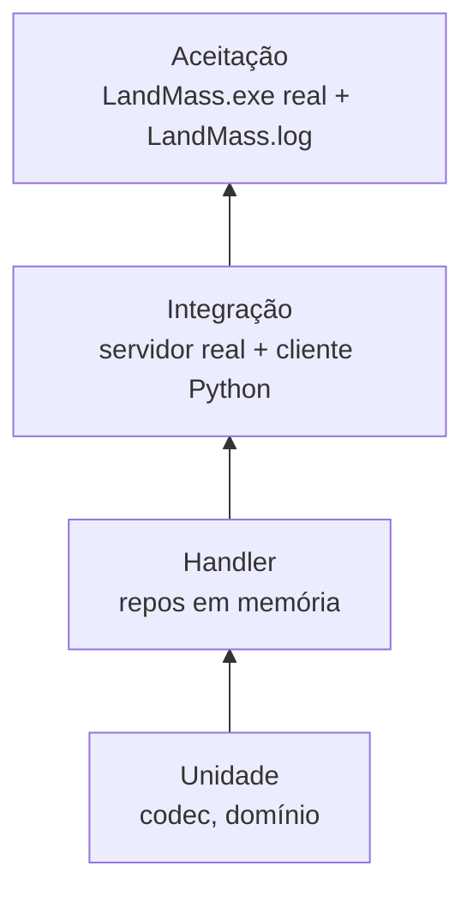

# Testes e qualidade

## Pirâmide



| Nível | Escopo | Ferramenta | Local |
|-------|--------|-----------|-------|
| Unidade | Codec (ida e volta, golden files), regras de domínio | pytest | `tests/test_protocol.py`, `tests/domain/` |
| Handler | Handler + repositórios em memória | pytest-asyncio | `tests/handlers/` |
| Integração | Servidor em porta efêmera + cliente de teste que fala o protocolo | pytest-asyncio | `tests/integration/` |
| Aceitação | Cliente real contra o emulador | script de automação | `scripts/` |

## Fixtures de captura

- Capture com `uv run landmass-emu sniff` (grava em `captures/`, fora do git).
- Copie capturas relevantes para `tests/fixtures/` com nome descritivo (`ms_login_guid_1.bin`).
- Toda mensagem com captura disponível tem teste que decodifica o `.bin` real.

## Gates

Execute antes de todo commit:

```
uv run ruff check .
uv run ruff format --check .
uv run mypy src
uv run pytest
```

- `mypy` em modo `strict`.
- Lint: `E, F, I, UP, B, SIM, ASYNC`.
