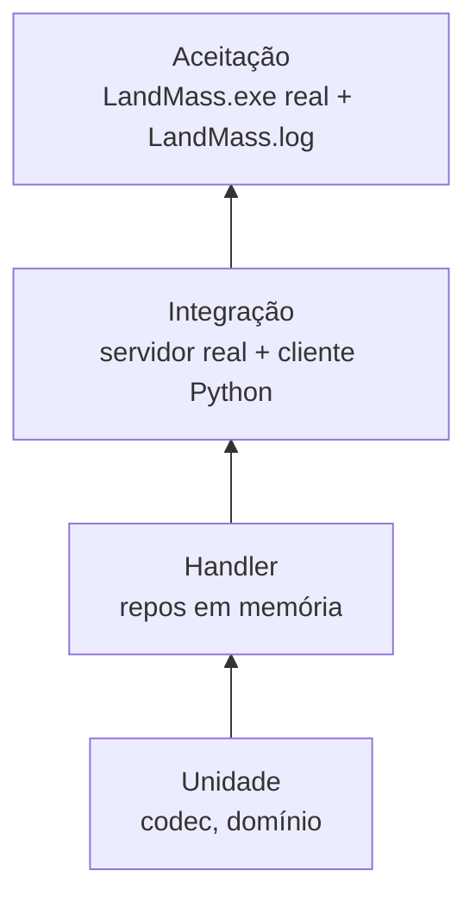

# Testes e qualidade

## Pirâmide



| Nível | Escopo | Ferramenta | Local |
|-------|--------|-----------|-------|
| Unidade | Codec (offsets, ida e volta, golden files), token, chave de sessão e configuração | pytest | `tests/test_protocol.py`, `tests/test_channel_protocol.py`, `tests/test_account.py`, `tests/test_session_keys.py`, `tests/test_settings.py` |
| Handler | Handler + repositórios em memória | pytest-asyncio | ainda não criado; no marco 1 os handlers são cobertos pela integração |
| Integração | Servidor em porta efêmera (0) + cliente de teste que fala o protocolo | pytest-asyncio | `tests/test_message_server.py`, `tests/test_channel_server.py` |
| Aceitação | Cliente real contra o emulador | script de automação | `scripts/` (ainda não criado) |

Os testes ficam planos em `tests/` (`test_<área>.py`). Testes nunca usam as portas 7312 a 7314 nem o banco padrão: use porta 0 e `tmp_path`.

## Fixtures de captura

- Capture com `uv run landmass-emu sniff` (grava em `captures/`, fora do git).
- Copie capturas relevantes para `tests/fixtures/` com nome descritivo (`ms_login_guid_1.bin`).
- Toda mensagem com captura disponível tem teste que decodifica o `.bin` real.

## Gates

Execute antes de todo commit:

```
uv run ruff check .
uv run ruff format --check .
uv run mypy src
uv run pytest
```

- `mypy` em modo `strict`.
- Lint: `E, F, I, UP, B, SIM, ASYNC`.
