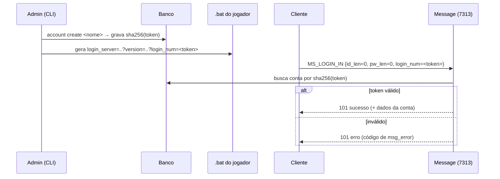

# Autenticação

## Comportamento do cliente

- O `LandMass.exe` exige `version=` e `login_num=` na linha de comando; sem eles encerra.
- O executável converte a linha de comando para minúsculas antes de ler `login_num`.
- Com `login_num` diferente de `DEVELOPERGUID`, o UnrealScript (`XInterface.u`, `NetGuidLogin`) envia o login automaticamente, sem formulário.
- Como a conversão para minúsculas impede `DEVELOPERGUID`, o formulário de usuário/senha é inalcançável.

Evidência: [`../../re/LandMass.exe/main_loop.c`](../../re/LandMass.exe/main_loop.c), [`../../re/NOTES.md`](../../re/NOTES.md).

## Modelo adotado

- `login_num` é a credencial do jogador: token de 32 caracteres hexadecimais minúsculos (`secrets.token_hex(16)`).
- Armazene `sha256(token)`; compare com `hmac.compare_digest`. Token de alta entropia dispensa hash lento.
- Uma conta pode ter um token ativo; regerar o token invalida o anterior.
- O fluxo `id`/`pw` do `MS_LOGIN_IN` permanece no codec. Se usado, armazene senha com `argon2id`.

## Sequência

## Distribuição aos jogadores

- Gere um `.bat` por jogador; nunca reutilize token entre jogadores.
- Trate o `.bat` como segredo: quem o possui entra na conta.
