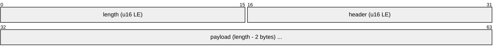

# Formato de fio

Aplica-se às portas 7313 (Message) e 7314 (Channel). Implementação: `net/framing.py`, `protocol/header.py`.
Evidência: [`../../re/NOTES.md`](../../re/NOTES.md), seção "Protocolo do Message/Channel".

## Frame



| Campo | Tipo | Regra |
|-------|------|-------|
| `length` | `u16 LE` | Tamanho do body; não inclui os 2 bytes do próprio campo. Máximo 65000. |
| body | `bytes[length]` | `header` + `payload`. |

Sem criptografia nem compressão na camada de transporte.

## Cabeçalho

```
header = (opcode << 5) | net_code      // u16 LE
opcode   = header >> 5                 // 11 bits
net_code = header & 0x1F               // 5 bits
```

| Serviço | `net_code` |
|---------|-----------:|
| Message | 13 |
| Channel | 14 |
| Update  | 12 |

- Rejeite (log + descarte) frames com `net_code` diferente do serviço da porta.
- Resposta a um pedido usa `opcode + 1`. Mensagens não solicitadas têm opcodes próprios.

## Structs

- Layout C de MSVC 7.1, little-endian, alinhamento natural de 4 bytes.
- Ignore o conteúdo de bytes de padding: o cliente envia lixo de pilha.
- Strings fixas: `char[N]` terminadas em `\0`, codificação `cp1252`.
- Dados variáveis seguem o struct fixo; os tamanhos vêm de campos do próprio struct (ex.: `MS_LOGIN_IN.id_len`).

## Keep-alive

- Cliente envia opcode 2 (sem payload) a cada 10 s, em ambos os serviços.
- Servidor desconecta após `LANDMASS_RECV_TIMEOUT` segundos sem tráfego.
- O cliente desiste após ~65 s sem resposta a pedidos pendentes (observado em captura).
