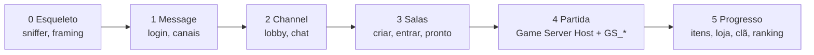

# Roadmap

| # | Entrega | Critério de aceite | Estado |
|---|---------|--------------------|--------|
| 0 | Esqueleto, sniffer, framing, cabeçalho, `MS_LOGIN_IN` | Captura do handshake real decodificada em teste | concluído |
| 1 | Message Server: login por token, lista de canais, CLI de contas | Cliente chega à tela de seleção de canal | concluído |
| 2 | Channel: entrada, lobby, chat, lista de salas | Dois clientes se veem no lobby | em andamento |
| 3 | Salas: criar, entrar, slots, pronto; decisão do Game Server Host | Dois clientes na mesma sala com "pronto" | — |
| 4 | Game Server Host + mensagens `GS_*` | Partida inicia e termina; resultado volta ao Channel | — |
| 5 | Persistência: itens, loja, quickslot, morats, clã, ranking | Estado sobrevive a reinício do servidor | — |
